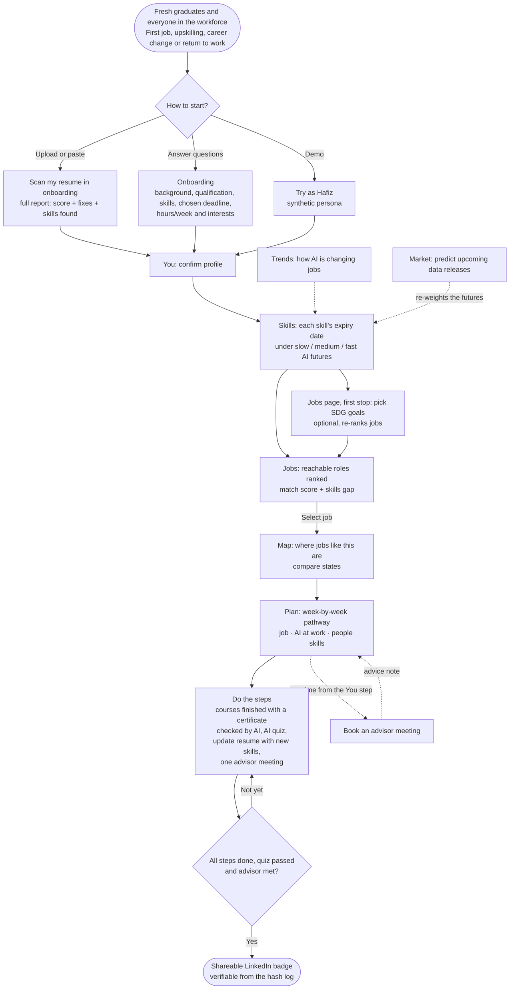
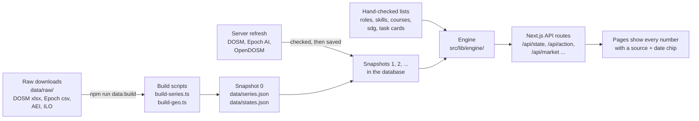

# Jobbery

**A deadline-based career plan for fresh graduates and everyone in the workforce.**

SDC Hackathon 2026 · Domain 1: Aiversecity Future-Ready Workforce · Licence: Apache-2.0

## Team information

| Field | Details |
|---|---|
| **Team name** | #slaynergy |
| **Team domain** | Domain 1: Aiversecity Future-Ready Workforce |
| **Team leader** | Yang Zi Chien |
| **University** | Xiamen University Malaysia |
| **Number of members** | 5 |

### Links

| Resource | Link or status |
|---|---|
| **GitHub repository** | https://github.com/yabgzichien/SDCHack-slaynergy |
| **Live demo** | https://sdc-runway.vercel.app/ |
| **RunPod endpoint** | Used: a serverless Qwen model (Qwen2.5 14B Instruct) for the AI resume reader, alongside the KrackedDev AI API |
| **Slide deck** | [PDF](submission/Jobbery%20pitch%20deck.pdf) · [PowerPoint](submission/Jobbery%20pitch%20deck.pptx) |
| **Demo video** | https://www.youtube.com/watch?v=pRHKh5LNF-s |
| **Preliminary proposal** | [PDF](submission/SDC2026_slaynergy_Preliminary.pdf) |
| **Revised PRD** | [PRD.md](submission/PRD.md) · [Section 19](#19-revised-prd), with [what changed and why](#192-what-changed-since-the-preliminary-round-and-why) |
| **Technical and tools declaration** | [PDF](submission/SDC2026_slaynergy_TechDeclaration.pdf) |
| **Replit proof of use** | [PDF](submission/Replit%20Proof%20Of%20Use.pdf) |
| **How to run** | [Section 15](#15-run-it) |
| **Project structure** | [Section 16](#16-project-structure) |
| **Replit usage** | [Section 17](#17-how-we-used-replit-and-runpod) |

### Run locally

```bash
cd src
npm install
npm run dev
```

Open http://localhost:3000. See [section 15](#15-run-it) for tests and other commands.

> The app's code lives in [`src/`](src/). For setup, the advisor passcode and a judge's walkthrough, see [`src/README.md`](src/README.md).

---

## Contents

1. [Summary](#1-summary)
2. [How it is human-centred](#2-how-it-is-human-centred)
3. [User flow](#3-user-flow)
4. [Data: where it comes from and how it gets into the app](#4-data-where-it-comes-from-and-how-it-gets-into-the-app)
5. [Future-role matching and skills gap](#5-future-role-matching-and-skills-gap)
6. [Personalised reskilling pathway](#6-personalised-reskilling-pathway)
7. [SDG mapping](#7-sdg-mapping)
8. [Handling uncertainty: how the forecasting works](#8-handling-uncertainty-how-the-forecasting-works)
9. [Job map and moving for work](#9-job-map-and-moving-for-work)
10. [Advisor meetings](#10-advisor-meetings)
11. [Learner motivation](#11-learner-motivation)
12. [Fairness check](#12-fairness-check)
13. [Coming next: inclusive design and automatic re-planning](#13-coming-next)
14. [Tech stack](#14-tech-stack)
15. [Run it](#15-run-it)
16. [Project structure](#16-project-structure)
17. [How we used Replit and RunPod](#17-how-we-used-replit-and-runpod)
18. [How we use AI](#18-how-we-use-ai)
19. [Revised PRD, and what changed since the preliminary round](#19-revised-prd)

---

## 1. Summary


*The landing page introduces Jobbery and the path from skills to jobs and learning.*

**The problem.** Fresh graduates need a path into their first job, while people already in the workforce need ways to develop their skills, change careers, return to work or find a new role after job loss. They need to understand how AI may change their skills, which jobs are growing, and what to learn first. Jobbery helps them plan around their own career goals, available study time and chosen deadline. Most "AI job risk" tools give one fixed score from old research.

**What Jobbery does.**

| Step | What the user gets |
|---|---|
| **Forecast** | Which skills and jobs are rising or falling, from public, dated data. Each skill gets an "expiry date". |
| **Match** | Jobs they can reach before their deadline, ranked with a score they can open up, and the skills they're missing. |
| **Plan** | A week-by-week plan with real free courses, AI-at-work practice and interview prep, every step tagged to a UN SDG. |

**What makes it different.** Forecasts aren't fixed. A **prediction market** (points only, never money) asks checkable questions about the next official data release. When the release comes out, the questions settle, and the futures that matched reality gain weight. Each user's dates, job ranking and plan then update.

---

## 2. How it is human-centred

- **The user decides.** Jobbery ranks options and explains them. It never picks a job for anyone, and there are no automated hiring decisions.
- **Built around a real deadline.** Every plan is measured against the months the user says they have and the hours a week they can study.
- **A person to ask, on the user's terms.** The user can book a meeting with an advisor whenever they want one. Nothing waits on an advisor's approval (see [section 10](#10-advisor-meetings)).
- **Every number shows its source.** Each forecast, demand figure and course has a source and date chip. Explanations are filled in from templates, so the app can't invent jobs, courses or statistics.
- **Plain language.** Pages are written for someone who has never read a chart like these: "about 14 in every 100 job ads", not "14.2% share".
- **Multilingual interface.** Already available in English, Bahasa Malaysia, Chinese and Tamil. Use the language picker in the header to switch languages.
- **Private by default.** A scanned resume is read in memory and never stored. If the user leaves AI on, the text is also sent once to the AI model (DeepSeek through the KrackedDev AI API, with RunPod and then Groq as backups) to read it. Only the score, the fixes and the skill IDs are kept. A course certificate is read the same way, once, and the file is never kept: the plan remembers only that the step was verified.
- **AI suggests, the user decides.** The resume reader is optional (DeepSeek through the KrackedDev AI API, with Qwen on RunPod and then Groq as backups). It proposes extra skills, each quoting the resume line it is based on, and better wording for weak lines. The user decides what to use: nothing is changed for them. The same models also read a course certificate, but only to copy down what is printed on it; plain code decides whether it counts (see [section 18](#18-how-we-use-ai)). Server checks drop any skill that is not on Jobbery's list or not backed by a real line, and any rewrite that adds a number the original line does not have. Scores, forecasts, matching and plans are computed by tested, readable code (`src/src/lib/engine/`), so the same inputs always give the same answer.
- **Every method cites its sources.** The two pages that show the working behind the forecast (the Skills page's "How we worked this out" and the "twice as capable every N months" panel) end each step with **What backs this up** and a numbered reference list of published studies. A study backs the method, not the values we chose, and values with no study behind them (for example the 0.6 and 1.6 speed multipliers) are stated as such.

---

## 3. User flow



**Who uses it**

| User | Need |
|---|---|
| **Fresh graduates** entering the workforce | To understand their skills, explore reachable first jobs and build a weekly learning plan |
| **Everyone in the workforce**, including employed people, career changers, jobseekers and people returning to work | To keep skills relevant, explore growing roles and plan their next career step around their own deadline |
| **Secondary: advisor**, for example an employment officer | To meet each user once (a mock interview, advice, or anything else they ask), seeing their profile and plan |
| **Forecasters** (simulated now, real people later) | To make checkable predictions about upcoming data and build a track record |

---

## 4. Data: where it comes from and how it gets into the app

### Sources

All data is public or synthetic. Every source is a **dated snapshot** saved in the repo.

| Source | What we take | Used for |
|---|---|---|
| **DOSM Job Market Insights** (2026 Q2 release, 18 Aug 2026) | Online job ads by occupation group, each quarter | Job demand; settles market questions |
| **Epoch AI benchmarking data** (retrieved 20 Oct 2026, CC-BY) | Best AI test scores over time | How fast AI is improving; settles market questions; history replay |
| **Anthropic Economic Index** (release 2026-06-26, Claude.ai usage Apr–May 2026, CC-BY; reviewed and re-pinned 29 Oct 2026) | Share of each occupation's tasks seen in real AI use, matched to our job codes with O\*NET 30.0 task lists and O\*NET's 2010-to-2019 code crosswalk | How fast AI is being adopted for each skill |
| **ILO 2025 GenAI exposure scores** (CC BY 4.0) | Exposure of each occupation (ISCO-08) to generative AI | How much of a skill AI could do |
| **O\*NET** (CC BY 4.0) | Occupation codes and task lists | Role IDs for 89 roles; task cards |
| **OpenDOSM** | Employment by industry and state, unemployment (2026 Q2), median wages (2025) | The job map |
| **DOSM Household Expenditure Survey 2024** (released 8 Oct 2025, Table 1.4) | Median monthly spending per person, by state | Living costs on the job map ("left after typical spending") |
| **geoBoundaries** (OpenStreetMap, ODbL) | State boundaries | Drawing the map |
| **UN SDG target text** (sdgs.un.org) | Official wording of each target | SDG tags |
| **Course list** (175 courses from 49 providers, at least 2 for every skill; each has a checked date and link status: the first 95 were opened in a browser on 30 Oct 2026, the 79 added on 31 Oct were checked by `scripts/check-links.mjs`; 173 load, 2 are marked "open manually") | Alison, Khan Academy, Great Learning, Coursera, Microsoft Learn, Kaggle, freeCodeCamp, HRD Corp, PERKESO and others | The reskilling plan |
| **Synthetic** | Demo personas and about 200 simulated forecasters | Demo only, always labelled |

### How it gets into the app

The server downloads the public source files itself and keeps each version as a numbered, hashed snapshot. Government releases come out quarterly as workbooks, so a dated file is more reliable than an API, and anyone can check exactly which data a prediction was settled on.



### AI trend signal layer

This is the part that tracks AI progress and turns it into skill and job signals.

| Signal | From | What the user sees |
|---|---|---|
| **Capability:** how fast AI is getting better | Epoch AI benchmark scores, by quarter | "How AI is changing jobs" chart on **Trends** |
| **Adoption:** how much AI is actually used for a task | Anthropic Economic Index task coverage | Feeds each skill's expiry date |
| **Exposure:** how much of an occupation's work AI could do | ILO 2025 exposure scores | Bands: "AI can do a lot / some / little of this work" |
| **Hiring:** which job groups are hired more or less | DOSM online job ads, by quarter | Office admin share of ads; demand per job group |

On **Statistics**, these lists form the **Future Skills Radar**: good jobs to aim for, jobs most at risk, skills worth learning and skills AI will take over first. Every row shows its number with its source and date, for example "AI exposure 0.70 · ILO 2025 · ads ▼4% · DOSM 2026 Q2". Jobs most at risk are sorted 70% by AI exposure (ILO) and 30% by falling job ads for their group (DOSM), so the list follows the release picker. If an automatic check of DOSM, Epoch AI or OpenDOSM fails, Statistics and Sources say which one and name the last good figures being shown.

These four signals combine into a **skill expiry date**: the year AI is expected to do most of the work behind a skill *and* be in common use for it (see [section 8](#8-handling-uncertainty-how-the-forecasting-works)).

### Does it update? Yes, automatically.


*The Sources page shows automatic checks, the active data version, source results and review alerts.*


*Official source cards show the latest figures and when the next releases are due.*

When someone uses the app and the last check is old enough, the server checks for new data in the background:
- **How often:** daily, and hourly around DOSM's release day. A daily Vercel Cron call (`/api/cron/refresh`, set in `vercel.json`, protected by `CRON_SECRET`) makes sure a check runs even on a day nobody visits.
- **Updated automatically:** DOSM Job Market Insights, Epoch AI benchmark results, and OpenDOSM's state labour force and wages.
- **Checked first:** new numbers must pass checks against the numbers they replace. If a check fails, the last good data stays and nothing settles.
- **When DOSM changes its website or workbook:** the plain rules go first. Only if they cannot find or read the DOSM release does a model (DeepSeek V4.1 Flash through the KrackedDev AI API, `src/lib/server/assist.ts`) help in two ways: it picks the right release page from DOSM's own list of releases, and it says where the occupation table now sits in a changed workbook. It only proposes. It never supplies a number: the figures are read from the workbook by the same code as before, and must pass the same checks plus one stricter one (the proposed layout must give back every quarter already held). It can only name a page from that list, anything it says is checked against what is really in the file, and each use is written to the tamper-evident log as `assist`. It is off without `LLM_API_KEY`, or with `DATA_ASSIST=off`, and then nothing changes.
- **Pinned, alert only:** the ILO exposure scores, the Anthropic Economic Index and DOSM's yearly Labour Force Survey tables. A new edition changes how they are measured, so the Sources page flags it for a person to review. Once reviewed, `npm run data:repin-aei` rebuilds the index into the starting data, and the server then saves one new, logged snapshot with only that source swapped. Nothing settles. The index was re-pinned this way to its 2026-06-26 release on 29 Oct 2026.
- **Pinned, no alert:** DOSM's spending per person by state (Household Expenditure Survey 2024). It is published only as a spreadsheet on dosm.gov.my, not on OpenDOSM, so the server cannot check it. It stays at the 2024 edition until someone downloads the next one and runs `npm run data:build`.

When new data goes live:
- Open questions whose answers are in settle, and settlements are final.
  - DOSM questions settle when the release arrives.
  - Epoch AI questions settle 30 days after their quarter ends, once late benchmark results are in.
- The futures are re-weighted, and every user's expiry dates, job ranking and plan are recomputed.
- A "what changed and why" panel lists each change with its source.
- The snapshot's hash goes into the tamper-evident log.

The next releases are **DOSM Jul–Sep 2026 (17 Nov 2026)** and **Epoch AI Oct–Dec 2026 (checked from 30 Jan 2027)**. Details: [src/README.md](src/README.md#data-and-updating).

### History: see the data as it stood on any past release

On **Statistics** (above the job lists) and **The Forecast** (above the questions), a small picker offers one stop per real DOSM Job Market Insights release: 2025 Q3 (published 28 Apr 2026), 2025 Q4 (25 May 2026), 2026 Q1 (25 Jun 2026) and Today (2026 Q2, 18 Aug 2026). The next release, 17 Nov 2026, is named beside it. Each date was read from that edition's own page on dosm.gov.my.

- **Statistics:** the job and skill lists change to what the data said on that day: DOSM quarters published by then, Epoch AI results settled by then, forecast weights replayed from the answers public by then, and skill dates counted from that day. Today's ILO and Anthropic Economic Index scores are used, and DOSM figures are as DOSM publishes them today.
- **The Forecast:** shows the questions that were open on that day, in the usual answered-card style, labelled as a past release whose questions have since settled with the real figures, and the AI outlook as it stood then.
- **What this release changed:** a folded list under the picker gives each change against the release before, with its source and date.
- **Read-only.** Nothing is settled, saved or changed. The picked release lives in the browser tab's memory; any other page, a reload or a new tab shows today. Engine: `src/src/lib/engine/history.ts` and `viewAsOf` in `view.ts`; API: `GET /api/history`; tests: `src/tests/history.test.ts`.

---

## 5. Future-role matching and skills gap


*Suggested jobs for the demo user, with skill overlap, reasons for the match and preparation time.*

Jobbery has **89 roles in 10 sectors** and **80 skills**. Each role lists the skills it needs, each weighted by importance (1–3), plus the qualification it requires.

### The match score

Every role gets a score from six parts. The user can open the score and see each part.

| Part | Weight | What it measures |
|---|---|---|
| **Skill overlap** | 25% | How much of the role's skill list (weighted by importance) the user already has |
| **Future outlook** | 28% | How long the role's skills are expected to last before AI does most of the work |
| **Job demand** | 18% | Whether DOSM job ads for this job group are rising or falling |
| **Reachable in time** | 15% | How much room the plan leaves before the user's deadline |
| **Qualifications and experience** | 10% | Half education fit, half experience fit (below) |
| **Interests** | 4% | How many of the role's themes match the interests the user picked |

**Qualifications and experience.** *Education fit* is 0.6 for meeting the level the role asks for, plus 0.2 for going beyond it and 0.2 for having studied the role's field. *Experience fit* is the user's years of work divided by the years the role's O\*NET Job Zone usually expects (0.5, 2, 3 or 5 years), never above 1; years in another field count for half. Each of the 89 roles carries its O\*NET Job Zone. The entry checks below are unchanged: this part only adds credit.

Adjustments:
- **Skills at risk:** a role whose skills mostly expire soon loses up to 8 points.
- **Few jobs nearby:** if the user says where they can work, a role that is scarce there loses up to 6 points. It is moved down, never hidden.
- **SDG goal bonus:** +12 points if the role serves a goal the user picked.

**Why this score, and what would raise it.** The job page shows each part as points out of its weight (for example "Skill overlap 13 of 25"), then the adjustments, rounded so the lines add up exactly to the score shown. Below, **What would raise it** lists each missing skill and two more hours a week, with the points each would add, for example "Learn procurement and vendor management: +12 points · Alison, 4 hours". The engine works each one out again, so learning that skill gives exactly the predicted score (tested). The points follow the AI speed picker and say which speed they assume. Pointing at a raiser draws its points as a faint striped extension on the bars it would move. Right under the total, a folded **equation** shows the same score as a sum (each part's value times its weight, then the adjustments). The header score, the bars, the raisers and the equation all follow the AI speed picker, so they always agree.

### Which roles are ranked

- **Only reachable roles are ranked.** Reachable means the plan's weeks fit within the user's deadline (months × 4.345, minus 2 weeks of slack).
- **Qualification check:** roles that need more than the user's highest qualification (SPM, diploma, degree...) aren't ranked. They're listed as longer-term paths.

### The skills gap

For each role, the gap is the list of skills the user doesn't have yet. Each missing skill shows:
- its importance to the role
- its expiry date under each future
- the course that will cover it

The more skills the user already has, the fewer weeks of practice the role needs. So a civil engineer is matched to civil engineering, not to something unrelated.

### Why this job: the explanation the user sees

The Jobs page reads as four numbered stops: **① causes you care about → ② your best job → ③ other good matches → ④ where in Malaysia**, with an amber highlight and a "Next: compare 4 other jobs" cue to guide a first-time user. Below them, one card lets the user keep their current job for now. Each job has its own icon, and every card shows the same three short reasons as chips:

| Reason | Built from |
|---|---|
| **Fits what you care about** | The interests the user picked that match the role, and whether it is in their field. If none match, it says so. |
| **Builds on what you know** | "You have 3 of 4 skills", and the skills still to add. |
| **Hard for AI to take over** | A one-line **human core** for each of the 89 roles (e.g. "Earning the trust of people new to banking, face to face"), with its O\*NET page as the source, then an honest split: what **AI will handle** (skills that fade, with dates) and what **stays yours** (lasting skills). |

**See why** opens the job page: the three reasons in full, the score breakdown, the skills gap, and **pay**. DOSM publishes no pay per job per state, so the page shows the national figure for the job's occupation group (DOSM Salaries & Wages Survey 2024: a median for managers, professionals and technicians, an average, labelled as such, for the other groups), next to all-user median pay by state.

**Select job** saves the choice and moves on to the Job Map. The map and the plan always follow the selected job, and switching jobs asks first if it would reset plan progress.

---

## 6. Personalised reskilling pathway


*The selected job becomes a learning pathway with a next step, weekly timeline and progress.*


*The weekly timeline shows every course, practice task and application step.*

The plan is built from the chosen role's skills gap, the user's **hours per week** and their **deadline**.

### How courses are chosen

1. Take the missing skills.
2. Pick the hand-checked free course that covers the most missing skills per hour.
3. Repeat until every skill is covered. A skill with no checked course would get a 20-hour HRD Corp e-LATiH placeholder, clearly marked; today every skill has a real course, and a test fails if one ever does not. Jobbery never invents a course.
4. **Weeks for a step = course hours ÷ hours per week**, rounded up. Steps run one after another, so the plan shows real calendar weeks.

The user can **swap a course** for another one that covers the same skills, where one exists.

**HRD Corp.** Only employers that pay the HRD Corp levy can claim training, so plans for people who keep a job (*bridge* and *reshape*) say: "If your company pays the HRD Corp levy, ask your employer to claim approved training for you." Laid-off workers get the PERKESO note instead.

### Three strands

Steps run in this order. Each strand has its own colour across the plan, the progress strip and the badges: **blue** job skills, **amber** AI at work, **purple** people skills.

| Strand | Steps | Estimated time |
|---|---|---|
| **Job** | Gap courses, e.g. Khan Academy, Microsoft Learn, Coursera, Kaggle, freeCodeCamp, HRD Corp. Each is finished with its certificate (below) | From each course's listed hours |
| **AI at work** | Free AI courses (finished with a certificate), then a **short quiz**: find the planted mistakes in a sample AI answer about a real task from the user's field. Optional portfolio piece: a reusable prompt + a "how I do this task" sheet | Course hours + 1 h |
| **People** | Free interview and workplace-communication courses (finished with a certificate) | From each course's listed hours |
| **People** | **Update your resume with your new skills.** No new upload: the resume is rebuilt from the profile, the skills from the start-up resume scan, finished courses (marked *New*) and the portfolio piece, beside a checklist of the scan's fixes | 2 h |
| **People** | Meet an advisor (a mock interview, the resume, or anything else) | 1 h |
| **Job** | Apply for roles | Final weeks |

The resume update comes **after** the courses, so it can show the new skills, and **before** the advisor, who can review it.

### Finishing a course: the certificate

A course step is not ticked by hand. The user opens the course, does it, then uploads the certificate (a JPG or PNG screenshot, or a PDF, up to 5 MB) on the Plan page.

1. **The AI only reads.** For a PDF, the text is pulled out with `unpdf` and sent as text; a picture is sent as an image. The model returns four things copied from the document: whether it is a certificate, whether it says the course was completed, the course title and the issuer.
2. **Plain code decides** (`checkCertificate` in `src/src/lib/engine/certificate.ts`). It must be a finished-course certificate; at least 60% of the step's title words must be in the certificate's course title; the issuer must not contradict the step's provider; and for a PDF, every word of the course title the model claims must really be in the file's text. Anything the model adds beyond those four fields is dropped.
3. **The server refuses to tick the step without it.** The checkbox is locked until the step is verified (un-ticking is always allowed). If the user swaps to another course, the new course needs its own certificate. The reader is the same provider chain as the resume reader; a picture needs a model that can see, set with `LLM_VISION_MODEL`. With no working provider the page says it cannot verify, rather than letting the step through.
4. **Nothing is kept.** The file is read once, in memory. The session keeps that the step was verified, and the event log keeps only the step and pass or fail.

Tests: `src/tests/certificate.test.ts`. A dashed **Demo** button (see [section 15](#15-run-it)) skips the check for developers and judges.

**Example (synthetic):** Hafiz, 27, a bank operations executive, has 5 months and 10 hours a week. His plan lists every step with a date range, hours, cost (free) and funding label (*Free*, *PERKESO training support* or *HRD Corp once re-employed*).

The quiz result, prompt and sheet become a **portfolio** the user can show an employer (folded away on the Plan page until opened). The finance task card (monthly budget variance report, from the O\*NET budget analyst task list) is written in full. Cards for the other sectors come in the final round.

**Plan types:** *switch* (train for a new job), *bridge* (keep the current job for income while training), *reshape* (stay in the job and add the skills that keep it going).

---

## 7. SDG mapping

**Every role and every skill is tagged** with at least one UN SDG target. Each tag has a one-line reason and the official UN target text as its source.

| Example | SDG target | Why |
|---|---|---|
| Accountant (role) | **8.2** Productivity through technology | Accurate accounts help organisations run productively |
| AML and compliance analyst (role) | **16.4** Fight illicit financial flows | Catches money laundering |
| ESG reporting assistant (role) | **12.6** Sustainability reporting | Helps companies report their impact |
| Healthcare claims administrator (role) | **3.8** Universal health coverage | Keeps claims moving for patients |
| Microfinance officer (role) | **8.10** Access to financial services | Brings credit to small businesses |
| Data entry (skill) | **8.5** Decent work for all | Reskilling away from routine work protects employment |

### SDGs change choices, not just labels

- **A goal picker re-ranks jobs.** It is the first stop on the Jobs page: five goals are shown (the ones the user's own reachable jobs serve come first), any other goal is found by search, and picking none is fine. The list never reorders while the user clicks. Matching roles get a bonus, and the trade-off is shown, e.g. "+3 weeks of training, but this role fights financial crime (SDG 16.4)".
- **Every plan step shows its SDG**, taken from the skill it teaches.
- **The Plan page shows each goal as an official-colour UN SDG tile** with its target numbers and the official target text, nothing hidden, including the new job's own goal.
- **The path contribution is added up from the plan itself.** The plan's hours are totalled by the SDG target of each skill they teach; a step that teaches several skills splits its hours evenly, so the totals add up to the plan's hours. For Hafiz: 58 hours toward **8.2** and 39 toward **8.5**. Every hour of learning (courses and practice) also counts, separately, toward **4.4** (skills for work): 74 hours. The card also says what share of course hours is free, and which target the new job serves.

Jobbery itself works toward **4.3, 4.4, 8.5, 8.6** (youth not in employment), **1.3** (social protection) and **10.2** (inclusion).

---

## 8. Handling uncertainty: how the forecasting works


*The Skills page compares slow, medium and fast AI futures and shows estimated dates for each skill.*


*The full skill list shows the estimated dates and which skills remain safer for longer.*

Nobody knows how fast AI will progress, so Jobbery doesn't give one forecast. It works with **three futures**, and a prediction market decides how likely each one is.

### Three futures

| Future | AI benchmark pace | Adoption speed | Office admin job ads |
|---|---|---|---|
| **Slow** | 60% of the recent pace | 0.6× | −0.05 points a quarter |
| **Medium** | Recent pace continues | 1.0× | −0.15 points a quarter |
| **Fast** | 160% of the recent pace | 1.6× | −0.35 points a quarter |

### Skill expiry dates

For each skill and each future:

```
readiness(year) = exposure × adoption(year)
exposure        = ILO exposure score of the skill's occupation
adoption(year)  = 1 − e^(−rate × speed × years),   rate = 0.15 + 0.6 × Economic Index task coverage
expiry year     = the first year readiness reaches 0.45
```

The date shown is the average of the three futures, weighted by how likely each one is. Skills that stay below the threshold in every future are marked **lasting**, e.g. people skills.

On the **Skills** page, the button **How we worked this out** opens `/skills/how`, which shows the working behind the headline "AI could do most of N of your M skills before 2031": your own skills in one table (exposure, coverage, the date under each speed, whether it is counted), then each step with a labelled formula and your numbers filled in (exposure, coverage, adoption rate, adoption curve, readiness, the date, Our forecast, the count and the likelihood of each speed), a readiness chart for any skill you pick, and what the numbers do not mean. The formulas are MathML and every number comes from the engine (`skillMath` in the view, built by `src/src/lib/engine/skill-math.ts` from `expiry-math.ts`, the same functions that make the dates). `src/tests/skill-math.test.ts` works the formulas out again by hand from the raw data and checks that the engine agrees, and that every sentence on the page is translated.

**What backs each step.** Every step on that page ends with a **What backs this up** box: plain sentences, each followed by numbered links to the published work behind the method. These are the ILO exposure index, the Anthropic Economic Index papers, the Bass model of how a technology spreads, opinion pools and Bayesian model averaging for blending the three futures, and proper scoring rules for the likelihoods. A reference list closes the page. The citations live in one file (`src/src/components/studies.ts`, 23 sources, kept in English in every language) and are shown by `References.tsx`. A source backs the method it is cited for, not the values we chose, and where nothing backs a value the page says so: "No study gives the 0.15 + 0.6K rate or the 0.45 line."

### Previewing an AI speed

One **AI speed** picker on Skills, Jobs, each job's page and Plan offers **Our forecast** (the default: the three futures, weighted) or **Slow**, **Medium** or **Fast** taken as certain. Picking a speed:

- **Re-ranks the jobs.** The same reachable jobs are scored with that future's adoption speed, which moves skill dates and each job's outlook. That future's office-admin drift also moves the job-demand part of the score: the latest DOSM share is projected four quarters ahead and labelled "projection, not a DOSM figure". Our forecast always uses the real DOSM figures.
- **Shows what moved.** Jobs shows the best job under that speed ("If AI is Fast, your best job would be ESG and sustainability reporting assistant, instead of Procurement officer"), and each card shows "▲ up 4 under Fast". Each job's page shows its rank and score under that speed.
- **Never changes the plan by itself.** Plan lists the best job under each speed with a "Plan for … instead" button. The pick is kept in the browser only and never saves the forecast's weights.

AI benchmark pace is a stated part of each future too. It drives the Skills page's "twice as capable every N months" and the prediction market's questions, but not the job ranking. The button **See the full calculation** on that page opens the working in seven steps (what is measured, the recent pace, Slow/Medium/Fast, Our forecast, how likely each speed is, what the speed changes on screen, what to keep in mind), with the formulas filled in with the live numbers and the same **What backs this up** boxes and reference list (`PaceExplain.tsx`). A test checks that Slow and Fast change the suggested job or the top five for at least three of the four demo profiles.

### The prediction market


*The Forecast page explains points-based predictions and when upcoming data releases will settle the questions.*

1. **Questions are checkable.** For example: "Will clerical job ads rise by more than 3 points in the next DOSM release?" Each question has three strike levels, and each is a Yes/No market priced by an LMSR (logarithmic market scoring rule) market maker.
2. **Each future makes a prediction** for every question.
3. The app keeps three possible **AI futures**—slow, medium, and fast—and adjusts how much weight it gives each one.
4. **No future drops below 5%**, so no future is ever ruled out.
5. **Forecasters are scored with the Brier score.** Influence moves to the most accurate ones.
6. **One person cannot swing a market.** A prediction moves the Yes % of an answer by a fixed 0.1%, however many points are staked, and one person's total push on an answer stays within 0.1%. The stake buys shares at the current %, and the page confirms the prediction and its effect on the market.
7. **About 200 simulated forecasters** (always labelled) earned track records by replaying real past releases. Judges and users can make predictions too, and each question shows what a Yes or No would change ("If Yes: data entry expires around Nov 2029").

### Being honest about it

- In the replay of real past releases, the market only just beats a coin flip (Brier 0.242 vs 0.25). One quarter's change is hard to call. The market's main job is to **score the futures in public against official numbers**.
- The crowd's forecasts for open questions are **hashed into the repo before the data comes out** (`src/anchors/`), so nobody, including us, can change them afterwards.
- Every screen shows "these are estimates, not certainties", and the user can switch between slow, medium and fast to see their dates under each. To disagree with the chances, they make a prediction on an open question, and that prediction is scored like everyone else's.
- **Points only, never money.** Gambling law, Muslim users and financially vulnerable users all rule out real money.

---

## 9. Job map and moving for work


*The job map compares estimated employment, state median pay and unemployment across Malaysia.*


*The table below the map lists all 16 states with estimated jobs, unemployment and median pay.*

The **Map** page shows, state by state, where jobs like the one the user picked are found. The map of Malaysia can be dragged and zoomed, with quick views for all of Malaysia, Peninsular Malaysia, Sabah and Sarawak.

- **The map comes first.** Above it, a compact row of job pills: the user's **suggested** jobs, **their current job** (labelled), and **Other jobs**, a searchable list where every job is marked *Not suggested* (or *Not in reach yet*, preview only). The selected job is highlighted amber and a short "Showing … · Selected" line pulses when it changes.
- **Colour the map by:** jobs like this · unemployment rate · median pay.
- **All 16 states as a table** is always shown under the map.
- **Each state's figures:** an estimated number of jobs like this, median monthly pay, unemployment rate, and **what is left after typical living costs**: median pay minus DOSM's median monthly spending per person, for example "≈ RM 1,730 a month" in Selangor (RM 3,547 − RM 1,820). The table adds a "Spending per person" column.
- **"Would you move for work?"** Pick your state, then any other state to compare: "*Selangor has 5.3× as many jobs like this as Kedah*", pay RM X higher or lower a month, about RM X more or less left a month after typical spending, unemployment Y points higher or lower.
- **A note on cost of living:** higher pay often comes with higher rent. The page suggests talking a move through with an advisor. Jobbery shows the figures; it doesn't tell anyone where to live.
- **Limits of the living-cost figure** (also shown on the page):
  - **Children count too.** "Spending per person" is a household's spending shared across everyone in it, children included. One adult living alone usually spends more, so "left after typical spending" flatters a single person's budget.
  - **Different years.** Pay is the 2025 median; spending is from the 2024 survey.
  - **All jobs, not this job.** Pay is the state median across all jobs, not pay for the selected job. Spending is a median for the whole state, so city and rural costs are mixed.
  - **No automatic updates.** The figure is not on OpenDOSM, so it is pinned (see "Does it update?").
  - Leftover amounts are rounded to RM 10 and labelled "estimate". It is a rough guide, not a budget.
- **Matching:** your home state alone never changes your matches (a test checks this). Only if you say you won't move do jobs that are scarce in your area move down the ranking. They are never hidden.

Malaysia publishes no open data on job ads by state and occupation. So "jobs like this" is an estimate from DOSM employment by industry and state, scaled to 2026 Q2, and it's labelled as one.

---

## 10. Advisor meetings

Every plan includes **one meeting with an advisor**, placed just before applying. The user chooses what it is for: a mock interview, the resume, advice, or anything else. **The plan step is ticked as soon as the meeting is booked** (and unticked if it is cancelled). The LinkedIn badge still needs the advisor's advice after the meeting. There is no separate sign-off: the human in the loop is the meeting.

**user side: "Meet an advisor" (`/advisor`)**
- A two-week calendar of 30-minute slots in Malaysia time, pooled across all advisors.
- Pick a slot and a topic (a mock interview, which job to aim for, courses and what they cost, fitting it into my time, interviews and applications, or something else), then write a question.
- Can be booked from the first step. A plan isn't required.
- One upcoming booking at a time. Either side can cancel, and the advisor gives a reason.
- A **Demo advisor** always has weekday slots, so the calendar is never empty.

**Advisor side: "Advisor view"** (`/counsellor`). Judges can sign in with one click as a demo advisor. A "needs you" strip at the top lists meetings still waiting for advice, with orange markers on anything waiting and green on what is done. Each meeting leads with the user, the job they are aiming for and their question; the date is a small line underneath. Their plan is shown as a timeline with an icon per step type. Two tabs:


*The demo advisor sees a meeting that needs advice, the user's question and the advice form.*

| Tab | What the advisor does |
|---|---|
| **Meetings** | Sees the user's question, profile, top jobs, plan, the futures behind the advice, and **their resume drawn as a page** (rebuilt from their profile and finished steps, never the uploaded file). Writes advice, which appears on the user's Plan page. |
| **My free times** | Opens or closes half-hour slots on a 14-day grid. |


*The advisor can review every step of the user's learning plan before giving advice.*


*The advisor sees the resume rebuilt from the demo profile and completed steps.*


*The user's profile, forecast assumptions and top job matches are shown together.*


*The advisor opens or closes half-hour slots and can see booked times in the two-week calendar.*

The hash log records "advice given", the advisor's ID and a **hash of the note, not the note itself**.

---

## 11. Learner motivation


*The plan shows progress toward skill and milestone badges, the advisor meeting and the pathway badge.*

- **A visible timeline.** A progress strip shows the weeks of the plan against the user's deadline, so they always know where they stand.
- **Badges as they go:** one for each finished step (e.g. "Tax preparation and compliance", "AI checker", "Resume updated"), plus milestones: *First step*, *Halfway*, *Every step done*. Each badge has its strand's colour and icon (blue job skills, amber AI, purple people, gold milestones). They are self-reported and labelled as such.
- **Real evidence, not just ticks.** The AI quiz and the resume update complete only when the work is done in Jobbery, and they build a portfolio.
- **A verified LinkedIn badge** at the end, issued once every step is done (including advice from an advisor) and checkable by anyone at `/badge/[id]` against the hash log. The badge page shows a certificate-style badge, the completed steps grouped by strand, and the log record. It says "pathway completed", never "certified".
- **The market leaderboard.** Forecasters earn an accuracy score, a rank and influence.


*The leaderboard shows rankings, accuracy scores and the influence earned by demo forecasters.*

---

## 12. Fairness check


*The live Trust page reports the fairness result and verifies the tamper-evident record chain.*

- **Age, gender and background are never inputs.** Matching accepts only a whitelisted input type (`pickInputs`): skills, months, hours, interests, goals, qualification, field and area.
- **A test proves it.** The same skills with a different age or gender give exactly the same matches. Another test checks that the user's home state alone never changes their matches.
- **The check runs live** on the **Trust** page (`/trust`, via `/api/fairness`), along with hash-chain verification and the full list of data sources.
- **Tamper-evident log.** Every prediction, settlement, advice note and badge is added to a hash-chained log. Its fingerprint is committed to this repo (`npm run anchor`).
- **Labelled simulations.** Simulated forecasters and demo personas are always marked as made up. No real CVs or personal data are used.


*The source list identifies the public datasets, their dates and the demo data.*

---

## 13. Coming next

### Inclusive design

- **Accessibility:** a full screen-reader and keyboard pass, larger text and high-contrast options, and plain-language reading level checks on every page.
- **Low-bandwidth mode** for older phones and patchy mobile data.
- **More starting points:** task cards for the other nine sectors, so users outside finance get the same AI-at-work practice.

### Automatic re-planning

Today, the plan is rebuilt when the user changes their job, hours or course choice, or when new data moves the futures. Next, it will re-plan on its own when life gets in the way:

- **Falling behind:** if steps run late, the remaining steps are rescheduled to the deadline, and the app says plainly whether the job is still reachable.
- **Running out of time:** if the deadline can no longer be met, it suggests a shorter route (a bridge plan or a closer role) for the user to choose.
- **New data:** when a release shortens a skill's expiry date, the steps for that skill move up or are swapped, and the "what changed and why" panel explains it.

The user always confirms a new plan before it replaces the old one.

---

## 14. Tech stack

| Layer | What we use |
|---|---|
| **Framework** | Next.js 16 (App Router), React 19, TypeScript |
| **Styling and motion** | Tailwind CSS 4, Framer Motion, Lucide icons |
| **Charts and map** | Recharts; a hand-drawn SVG map of Malaysia from geoBoundaries (no third-party base map) |
| **Engine** | Pure TypeScript in `src/lib/engine/`: LMSR market, simulated forecasters, history replay, futures weights, expiry dates, matching, planning |
| **Storage** | PostgreSQL (`pg`) when `DATABASE_URL` is set; SQLite (`better-sqlite3`) when running locally |
| **Sessions and trust** | Signed session cookie; SHA-256 hash-chained log, with its fingerprint committed to Git |
| **Resume scan** | `unpdf` (PDF) and `mammoth` (Word), with rule-based scoring. Optional AI reader: DeepSeek V4.1 Flash through the KrackedDev AI API, then Qwen2.5 14B Instruct on RunPod Serverless, then Qwen3.8 27B on Groq (`src/lib/server/ai-resume.ts`), with server-side checks and a rule-only fallback. The same providers read course certificates (`src/lib/server/ai-certificate.ts`; `unpdf` pulls the text from a PDF). |
| **Data pipeline** | The server fetches DOSM, Epoch AI and OpenDOSM itself, checks them and saves hashed snapshots (`src/lib/server/refresh.ts`); build scripts (`build-series.ts`, `build-geo.ts`) make the starting snapshot from raw downloads |
| **Tests** | Vitest (`src/tests/`): fairness, LMSR, futures weights, replay, matching, planning, log, data refresh and its AI helper, history, living costs, skill-date maths, AI resume reader, certificate check, SDG focus, translations. Playwright checks pages for layout overflow. |
| **Hosting** | Vercel, with a daily Vercel Cron call for the data refresh. No GPU on the web host: the AI models run on hosted services (the KrackedDev AI API, then a serverless Qwen model on RunPod, then Groq). |

---

## 15. Run it

```bash
cd src
npm install
npm run dev
```

The app runs at http://localhost:3000. Other commands:

| Command | What it does |
|---|---|
| `npm test` | Runs the unit tests |
| `npm run test:layout` | Runs the Playwright page-layout checks |
| `npm run typecheck` | Checks types |
| `npm run lint` | Runs ESLint |
| `npm run data:build` | Rebuilds the starting data snapshot from `data/raw/` (series, map and living costs) |
| `npm run data:refresh` | Checks the sources for new data now (the app also does this by itself) |
| `npm run data:repin-aei` | After a person has reviewed a new Anthropic Economic Index release, rebuilds the index into the starting data |
| `npm run anchor` | Writes the hash log's fingerprint to `anchors/` |
| `npm run anchor:forecasts` | Hashes the crowd's forecasts for the open questions into `anchors/` |

Without `DATABASE_URL`, sessions are kept in `.data/jobbery.db` (SQLite). For a deployment with PostgreSQL, set `DATABASE_URL` and a random `SESSION_SECRET` in the Vercel project environment. Add `RUNPOD_API_KEY` and `RUNPOD_ENDPOINT_ID` there for the AI resume reader, and optionally `GROQ_API_KEY` as the backup (locally, use `src/.env.local`, which is gitignored). With none of them, the rule scan runs alone. Add `LLM_API_KEY` (and optionally `LLM_BASE_URL`, `LLM_MODEL`) for the data-source finder described under "Does it update?"; never commit it. Add `LLM_VISION_MODEL` (the gateway's model that can read images) so JPG and PNG certificates can be checked; PDF certificates need only the providers above. Add `CRON_SECRET` so the daily refresh call is accepted (without it `/api/cron/refresh` refuses everything). `src/.env.example` lists every variable.

### Demo shortcuts

Steps that normally need the user to stop and think have a dashed amber **"Demo:"** button, so the whole pathway can be shown in a few minutes:

| Where | Button | What it does |
|---|---|---|
| Course steps (`/plan`) | Demo: skip all courses and go to the resume step (for developers) | Finishes every course step with no certificate, passes the AI quiz if the plan has one and ticks the plain practice steps, so the plan lands on the resume step. These steps are marked as skipped in the session, not verified. |
| AI quiz (`/plan/task`) | Demo: mark every mistake correctly | Passes the quiz |
| Portfolio piece (`/plan/task`) | Demo: fill in a sample and save | Saves a sample prompt and sheet |
| Resume update (`/plan/resume`) | Demo: apply every fix and finish | Ticks every fix and finishes the step |
| Meet an advisor (`/advisor`) | Demo: skip to after the meeting | Sends labelled sample advice to the user's own booked meeting |

The sample user Hafiz and a finance job (e.g. tax preparer) show every step; quizzes for other fields come later.

For the advisor passcode and a judge's walkthrough, see [`src/README.md`](src/README.md).

---

## 16. Project structure

```text
.
├── .gitignore
├── .replit  # Repository-root run and deployment commands
├── LICENSE
├── README.md
├── src/  # Next.js application root; run npm commands here
│   ├── .env.example  # Environment variable template
│   ├── .gitignore
│   ├── .replit
│   ├── eslint.config.mjs  # Lint configuration
│   ├── LICENSE
│   ├── next.config.ts  # Next.js build configuration
│   ├── package-lock.json  # Locked dependency versions
│   ├── package.json  # Dependencies and npm scripts
│   ├── playwright.config.ts  # Browser-test configuration
│   ├── README.md
│   ├── tsconfig.json  # TypeScript configuration
│   ├── vercel.json  # Daily data-refresh cron
│   ├── vitest.config.mts  # Unit-test configuration
│   ├── anchors/
│   │   └── forecasts-2026Q4.json
│   ├── data/  # Committed data snapshots
│   │   ├── courses.json
│   │   ├── logos.json
│   │   ├── occupations.json
│   │   ├── personas.json
│   │   ├── roles.json
│   │   ├── sdg.json
│   │   ├── series.json
│   │   ├── skill-keywords.json
│   │   ├── skills.json
│   │   ├── states.json
│   │   └── task-cards.json
│   ├── public/  # Production assets, including mascot images and illustrations
│   │   ├── geo/
│   │   │   └── malaysia-states.json
│   │   └── screenshots/  # README screenshots
│   ├── scripts/  # Data collection, builds, refresh and anchoring
│   │   ├── anchor-forecasts.ts
│   │   ├── anchor-log.mjs
│   │   ├── build-geo.ts
│   │   ├── build-map.mjs
│   │   ├── build-series.ts
│   │   ├── build-spending.ts
│   │   ├── check-links.mjs
│   │   ├── data-refresh.ts
│   │   ├── extract-state-occupation.mjs
│   │   ├── fetch-logos.mjs
│   │   ├── fetch-sources.sh
│   │   ├── prepare-sdg-icons.mjs
│   │   └── repin-aei.ts
│   ├── src/  # Application source code
│   │   ├── mathml.d.ts
│   │   ├── app/  # Pages, layouts, styles and API routes
│   │   │   ├── globals.css
│   │   │   ├── landing-v2.css
│   │   │   ├── layout.tsx
│   │   │   ├── page.tsx
│   │   │   ├── about/
│   │   │   │   └── page.tsx
│   │   │   ├── advisor/
│   │   │   │   └── page.tsx
│   │   │   ├── api/
│   │   │   │   ├── action/
│   │   │   │   │   └── route.ts
│   │   │   │   ├── certificate/
│   │   │   │   │   └── route.ts  # Reads a course certificate
│   │   │   │   ├── counsellor/
│   │   │   │   │   └── route.ts
│   │   │   │   ├── cron/
│   │   │   │   │   └── refresh/
│   │   │   │   │       └── route.ts
│   │   │   │   ├── data/
│   │   │   │   │   └── route.ts
│   │   │   │   ├── fairness/
│   │   │   │   │   └── route.ts
│   │   │   │   ├── history/
│   │   │   │   │   └── route.ts
│   │   │   │   ├── leaderboard/
│   │   │   │   │   └── route.ts
│   │   │   │   ├── log/
│   │   │   │   │   └── route.ts
│   │   │   │   ├── market/
│   │   │   │   │   └── route.ts
│   │   │   │   ├── meetings/
│   │   │   │   │   └── route.ts
│   │   │   │   ├── raise/
│   │   │   │   │   └── route.ts
│   │   │   │   ├── resume/
│   │   │   │   │   └── route.ts
│   │   │   │   └── state/
│   │   │   │       └── route.ts
│   │   │   ├── badge/
│   │   │   │   └── [id]/
│   │   │   │       └── page.tsx
│   │   │   ├── changes/
│   │   │   │   └── page.tsx
│   │   │   ├── counsellor/
│   │   │   │   └── page.tsx
│   │   │   ├── courses/
│   │   │   │   ├── courses.css
│   │   │   │   └── page.tsx
│   │   │   ├── employer/
│   │   │   │   └── page.tsx  # Illustrative employer view (demo data)
│   │   │   ├── forecast/
│   │   │   │   └── page.tsx
│   │   │   ├── futures/
│   │   │   │   └── page.tsx
│   │   │   ├── goals/
│   │   │   │   └── page.tsx
│   │   │   ├── jobs/
│   │   │   │   ├── jobs.css
│   │   │   │   ├── page.tsx
│   │   │   │   ├── [id]/
│   │   │   │   │   └── page.tsx
│   │   │   │   └── all/
│   │   │   │       └── page.tsx
│   │   │   ├── leaderboard/
│   │   │   │   └── page.tsx
│   │   │   ├── map/
│   │   │   │   └── page.tsx
│   │   │   ├── market/
│   │   │   │   ├── market.css
│   │   │   │   ├── page.tsx
│   │   │   │   └── [id]/
│   │   │   │       └── page.tsx
│   │   │   ├── plan/
│   │   │   │   ├── page.tsx
│   │   │   │   ├── resume/
│   │   │   │   │   └── page.tsx
│   │   │   │   └── task/
│   │   │   │       └── page.tsx
│   │   │   ├── profile/
│   │   │   │   └── page.tsx
│   │   │   ├── radar/
│   │   │   │   └── page.tsx
│   │   │   ├── resume/
│   │   │   │   └── page.tsx
│   │   │   ├── skills/
│   │   │   │   ├── page.tsx
│   │   │   │   └── how/
│   │   │   │       └── page.tsx
│   │   │   ├── sources/
│   │   │   │   └── page.tsx
│   │   │   ├── start/
│   │   │   │   ├── page.tsx
│   │   │   │   ├── steps.ts
│   │   │   │   └── summary.tsx
│   │   │   ├── trends/
│   │   │   │   ├── page.tsx
│   │   │   │   └── trends.css
│   │   │   └── trust/
│   │   │       └── page.tsx
│   │   ├── components/  # Shared UI components
│   │   │   ├── AiTrendCharts.tsx
│   │   │   ├── AppProvider.tsx
│   │   │   ├── AppShell.tsx
│   │   │   ├── CertificateUpload.tsx  # Certificate upload on the Plan page
│   │   │   ├── CustomCursor.tsx
│   │   │   ├── ExpiryTrack.tsx
│   │   │   ├── ForecastDetails.css
│   │   │   ├── ForecastDetails.tsx
│   │   │   ├── ForecastNav.tsx
│   │   │   ├── GoalsPicker.tsx  # SDG goal picker on the Jobs page
│   │   │   ├── history.css
│   │   │   ├── History.tsx
│   │   │   ├── I18nProvider.tsx
│   │   │   ├── JobberyStrip.tsx
│   │   │   ├── JobBits.tsx
│   │   │   ├── JobIcon.tsx
│   │   │   ├── JobPicker.tsx
│   │   │   ├── JobsNav.tsx
│   │   │   ├── journey-bar.css
│   │   │   ├── Journey.tsx
│   │   │   ├── LandingForecast.tsx
│   │   │   ├── LandingIntro.tsx
│   │   │   ├── LandingLiveMarket.tsx
│   │   │   ├── LandingMap.tsx
│   │   │   ├── LandingSdgAnimation.tsx
│   │   │   ├── LanguageSwitcher.tsx
│   │   │   ├── MalaysiaMap.tsx
│   │   │   ├── market-odds-bar.css
│   │   │   ├── MarketBoard.css
│   │   │   ├── MarketBoard.tsx
│   │   │   ├── MarketCards.css
│   │   │   ├── MarketCards.tsx
│   │   │   ├── MarketOddsBar.tsx
│   │   │   ├── MarketTabs.tsx
│   │   │   ├── mathml.tsx
│   │   │   ├── Meetings.tsx
│   │   │   ├── pace-text.ts
│   │   │   ├── PaceExplain.tsx
│   │   │   ├── PageTransition.tsx
│   │   │   ├── Pathway.tsx
│   │   │   ├── References.tsx  # "What backs this up" boxes and reference lists
│   │   │   ├── ReleaseInfo.css
│   │   │   ├── ReleaseInfo.tsx
│   │   │   ├── ReleaseOverlay.tsx
│   │   │   ├── ResumeGraphic.tsx
│   │   │   ├── ResumeOriginal.tsx
│   │   │   ├── ResumeReport.tsx
│   │   │   ├── ResumeScoreExplain.tsx
│   │   │   ├── ResumeSheet.tsx
│   │   │   ├── ScoreBreakdown.tsx
│   │   │   ├── ScoreRing.tsx
│   │   │   ├── SdgFocus.tsx
│   │   │   ├── SdgIcon.tsx
│   │   │   ├── Segmented.tsx
│   │   │   ├── SiteHeader.tsx
│   │   │   ├── skill-math-text.ts
│   │   │   ├── SkillMathExplain.tsx
│   │   │   ├── SkipLink.tsx
│   │   │   ├── SourceDisclosure.tsx
│   │   │   ├── SourceDown.tsx
│   │   │   ├── SpeedBar.tsx
│   │   │   ├── StepNav.tsx
│   │   │   ├── strands.ts
│   │   │   ├── studies.ts  # Published sources cited by the explainer pages
│   │   │   ├── ui.tsx
│   │   │   ├── useSelectJob.ts
│   │   │   ├── useSpeed.ts
│   │   │   └── YourPredictions.tsx
│   │   └── lib/
│   │       ├── build-resume.ts
│   │       ├── last-good.ts
│   │       ├── legacy.ts
│   │       ├── logo-domain.mjs
│   │       ├── malaysia-map.json
│   │       ├── map-figures.ts
│   │       ├── map-scale.ts
│   │       ├── market-math.ts
│   │       ├── positions.ts
│   │       ├── sample-resume.ts
│   │       ├── sdgFocus.ts
│   │       ├── speed.ts
│   │       ├── suggested.ts
│   │       ├── datasrc/
│   │       │   ├── aei.ts
│   │       │   ├── mapping.ts
│   │       │   ├── parse.ts
│   │       │   └── validate.ts
│   │       ├── engine/  # Forecasting, matching, learning plans and market logic
│   │       │   ├── calendar.ts
│   │       │   ├── certificate.ts  # Decides whether a certificate counts
│   │       │   ├── data.ts
│   │       │   ├── expiry-math.ts
│   │       │   ├── expiry.ts
│   │       │   ├── futures-def.ts
│   │       │   ├── futures.ts
│   │       │   ├── geo.ts
│   │       │   ├── history.ts
│   │       │   ├── lmsr.ts
│   │       │   ├── market.ts
│   │       │   ├── matching.ts
│   │       │   ├── math.ts
│   │       │   ├── meetings.ts
│   │       │   ├── pathway.ts
│   │       │   ├── plan.ts
│   │       │   ├── questions.ts
│   │       │   ├── replay.ts
│   │       │   ├── resume-layout.ts
│   │       │   ├── resume.ts
│   │       │   ├── review.ts
│   │       │   ├── skill-math.ts
│   │       │   ├── state.ts
│   │       │   ├── tape.ts
│   │       │   ├── view.ts
│   │       │   └── world.ts
│   │       ├── i18n/  # Translations and language helpers
│   │       │   ├── dates.ts
│   │       │   ├── dom.ts
│   │       │   ├── index.ts
│   │       │   ├── ms.ts
│   │       │   ├── ta.ts
│   │       │   ├── zh.ts
│   │       │   └── rows/
│   │       │       ├── coverage.ts
│   │       │       ├── forecast.ts
│   │       │       ├── history.ts
│   │       │       ├── humanedge.ts
│   │       │       ├── index.ts
│   │       │       ├── jobs.ts
│   │       │       ├── map.ts
│   │       │       ├── misc.ts
│   │       │       ├── misc2.ts
│   │       │       ├── pace.ts
│   │       │       ├── plan.ts
│   │       │       ├── resumescore.ts
│   │       │       ├── roles.ts
│   │       │       ├── sdg.ts
│   │       │       ├── skillmath.ts
│   │       │       ├── skills.ts
│   │       │       ├── skillspage.ts
│   │       │       ├── sources.ts
│   │       │       ├── speed.ts
│   │       │       ├── start.ts
│   │       │       ├── taskcard.ts
│   │       │       ├── trust.ts
│   │       │       └── updates.ts
│   │       └── server/  # Storage, sessions, data refresh and AI readers
│   │           ├── ai-certificate.ts  # Reads what a certificate says
│   │           ├── ai-resume.ts  # Reads a resume
│   │           ├── assist.ts  # Data-source finder (proposes only)
│   │           ├── counsellor.ts
│   │           ├── meetings.ts
│   │           ├── refresh.ts
│   │           ├── respond.ts
│   │           ├── session.ts
│   │           ├── sources.ts
│   │           └── store.ts
│   └── tests/  # Unit tests and browser layout checks
│       ├── aei-repin.test.ts
│       ├── ai-resume.test.ts
│       ├── certificate.test.ts
│       ├── client-bundle.test.ts
│       ├── cron-refresh.test.ts
│       ├── data-assist.test.ts
│       ├── data-refresh.test.ts
│       ├── engine.test.ts
│       ├── history.test.ts
│       ├── i18n.test.ts
│       ├── layout-overflow.spec.ts
│       ├── living-costs.test.ts
│       ├── rename.test.ts
│       ├── scenarios.test.ts
│       ├── sdg-focus.test.ts
│       ├── skill-math.test.ts
│       └── spot-checks.test.ts
└── submission/  # Submission documents and pitch deck
    ├── Jobbery pitch deck.pdf
    ├── Jobbery pitch deck.pptx
    ├── PRD.md  # Revised PRD (the same text as section 19)
    ├── Replit Proof Of Use.pdf
    ├── SDC2026_slaynergy_Preliminary.pdf
    └── SDC2026_slaynergy_TechDeclaration.pdf
```

This tree lists the code, configuration, datasets and submission files. Individual images in `src/public/` and `src/public/screenshots/` are grouped under their folders.

The outer `src/` is the application root; `src/src/` contains its Next.js source code.
Local dependencies, build output, databases, logs and raw data downloads are excluded from Git.

---

## 17. How we used Replit and RunPod

**Replit.** We used Replit for code generation only.

**RunPod.** The serverless Qwen model behind the AI resume reader runs on RunPod, and it is the only part that needs a GPU. The reader first calls the KrackedDev AI API. If that fails, it calls our serverless Qwen model, Qwen2.5 14B Instruct, on a RunPod Serverless vLLM endpoint (billed per millisecond, only while a worker runs), with Groq as the last backup. Resume scoring is rule-based and the forecasting engine is plain TypeScript.

## 18. How we use AI

Jobbery uses AI in two ways: GenAI models that read documents (a resume, a course certificate and, rarely, a changed DOSM page), and a forecasting engine that learns from data. Neither one makes decisions for the user.

### 18.1 GenAI resume reader

| | |
|---|---|
| **Model** | DeepSeek V4.1 Flash (`deepseek-v4.1-flash`) through the KrackedDev AI API. Backups: Qwen2.5 14B Instruct (`Qwen/Qwen2.5-14B-Instruct`) on RunPod Serverless (vLLM), then Qwen3.8 27B (`qwen/qwen3.8-27b`) through the Groq API |
| **Code** | `src/src/lib/server/ai-resume.ts`, called from `src/src/app/api/resume/route.ts` |
| **Must-have it serves** | Skills profile intake |
| **Switch** | "Also let AI read it" checkbox on the resume question of the onboarding (on by default) |

**What it does.** After the rule-based scan, the model reads the resume and returns JSON with three things:
1. **Extra skills** the keyword rules missed. They can only come from Jobbery's own list of 80 skills, and each one must quote the resume line it is based on.
2. **Skills outside the list** (for example *SAP FICO* or *Tally ERP*). These are never used in matching and are not shown in the report. The name must appear in the resume as a whole word, with a quote.
3. **Better wording** for up to 5 weak lines (for example "Responsible for processing loan applications" becomes "Processed [how many] loan applications and verified supporting documents").

**The user stays in control.** AI skills come ticked at the skills question, with a note to untick any that are not true, so each one counts only if the user leaves it ticked. Better wording appears under Suggested fixes in the report, for the user to copy into their own resume if they want it. Nothing changes unless the user chooses it. The resume score always comes from the rules, never from the AI.

**How the resume score is worked out, on screen.** The score is seven rule-based parts that add up to 100: clear sections (15), contact details (8), results with numbers (22), strong action words (15), length and clarity (10), skills a recruiter can find (12) and readiness for AI-era jobs (18). Under each bar the page shows the rule with the resume's own counts, for example "1 of 4 bullets have a number. 22 × (1 ÷ 4 ÷ 50%), at most 22." A last line adds the parts up: "15 + 8 + 11 + 13.5 + 4 + 12 + 10.8 = 74.3 → 74".

**Checks so it cannot make things up.** The server drops anything the resume does not support (`checkAiRead`, tested in `src/tests/ai-resume.test.ts`):
- a skill ID that is not on Jobbery's list, or whose quote is not in the resume
- a rewrite of a line that is not in the resume
- a rewrite that adds a number the original line does not have (missing figures must be placeholders like `[how many]`)

The prompt also tells the model not to add purposes or overstate the role ("helped with" becomes "Supported", never "Led"), and to ignore instructions written inside the resume. We tested this with a resume that tried to inject a fake skill and fake numbers; both were ignored.

**Privacy.** The text is read in memory for that request and never stored or logged. If AI is on, it is sent to the KrackedDev AI API to be read, and to RunPod or then Groq only if the one before fails. Only counts (how many AI skills and rewrites) go in the event log.

**Which model.** The reader first calls the KrackedDev AI API (`LLM_API_KEY`, `LLM_BASE_URL`, model `LLM_MODEL` or `deepseek-v4.1-flash`, 20 s). After an error or a timeout it tries `Qwen/Qwen2.5-14B-Instruct` on a RunPod Serverless vLLM endpoint (`RUNPOD_API_KEY`, `RUNPOD_ENDPOINT_ID`, 20 s), then Groq (`qwen/qwen3.8-27b`, `GROQ_API_KEY`, 15 s). A cold RunPod worker can take longer than its 20 s, and then Groq answers.

**Fallback.** With no key set, or if every provider fails or times out, the rule scan runs alone and the page says so. With AI switched off, the page says it only recognises skills from the list. Groq's free tier allows about 1,000 output tokens a minute (about two scans). After a rate-limit reply, the server waits once if the wait is short, and otherwise falls back to the rules.

### 18.2 GenAI certificate reader

| | |
|---|---|
| **Model** | The same chain as the resume reader: DeepSeek V4.1 Flash through the KrackedDev AI API, then Qwen2.5 14B Instruct on RunPod, then Groq. A JPG or PNG needs a model that can see images (`LLM_VISION_MODEL` on the gateway) |
| **Code** | `src/src/lib/server/ai-certificate.ts` reads; `src/src/lib/engine/certificate.ts` decides; called from `src/src/app/api/certificate/route.ts` |
| **Must-have it serves** | Personalised reskilling pathway (proof that a step is done) |
| **Switch** | None. A course step is finished with a certificate, unless the developer **Demo** button is used |

**What it does.** The model reads a finished-course certificate (a PDF's text, or a picture) and returns four fields as JSON: whether it is a certificate, whether it says the course was completed, the course title and the issuer, copied as printed. It never says whether the certificate is good enough. That is `checkCertificate`, plain code: the course title must share at least 60% of the step's title words, the issuer must not contradict the step's provider, and for a PDF every word of the course title must really be in the file's text. Any other field the model adds is dropped (`parseCertRead`). The prompt tells it to ignore instructions written inside the document.

**Privacy.** The file (up to 5 MB) is read in memory for that one request, never stored or logged. The session keeps that the step was verified, and the event log keeps only the step and pass or fail.

**Fallback.** If no provider answers, the page says it could not read or verify the certificate, and the step stays open. It never ticks a step it could not check.

### 18.3 A forecast that learns

The forecasting engine (`src/src/lib/engine/`) is statistical learning, not a language model. It keeps three possible speeds of AI change (slow, medium, fast) and weights them by how well each one predicted past official releases (DOSM job ads, Epoch AI benchmarks): log-likelihood scoring with fading memory, a form of Bayesian model averaging. A prediction market (LMSR, points only) adds the crowd's view of the next release. When a release settles the questions, the weights update, and so do every user's skill dates, job ranking and plan. See [section 8](#8-handling-uncertainty-how-the-forecasting-works).

### 18.4 What is not AI

Matching, the resume score, plans and every explanation are computed by readable rules and templates, so the same inputs always give the same answer and nothing invents jobs, courses or statistics. Whether a certificate counts is decided by code, not by the model. The data-source finder (section 4) only proposes where to look; it never supplies a number. There is no chatbot.

### 18.5 AI used to build Jobbery

We used Claude Code (Anthropic) as a coding assistant while writing this repository. All code was reviewed and tested by the team.

---

## 19. Revised PRD

The revised Product Requirements Document for the final round. It says what Jobbery must do and how, and in **19.2** what changed since the preliminary round (25 October 2026) and why. The same text is in [`submission/PRD.md`](submission/PRD.md). Version 2.0, 31 October 2026.

### 19.1 Summary

Jobbery gives fresh graduates and people already in work a **deadline-based career plan**. It forecasts which skills and jobs AI will change, from public, dated data. It ranks the jobs the person can reach before their deadline, with a score they can open up. It then builds a week-by-week plan from real free courses, with every step tagged to a UN SDG. A **points-only prediction market**, whose questions settle on real data releases, decides how likely each of three AI futures is.

- **Problem:** people do not know which of their skills AI will take over, which jobs are growing, or what to learn first. Existing "AI job risk" tools give one fixed score from old research.
- **Approach:** public, dated data → three possible AI futures, weighted by real releases and a points-only market → ranked reachable jobs with a skills gap → an SDG-tagged plan that fits the person's deadline, with one meeting with an advisor.
- **Outcome:** the person gets from "who I am today" to a sourced plan in minutes. They choose; nothing is decided for them, and a person (the advisor) is there to ask.

### 19.2 What changed since the preliminary round, and why

The product idea, the six must-haves, the three AI futures and the points-only market did not change. What changed is how well each part stands up to the checks that judges are told to run: switch the AI speed, change the trend data, open a course link, ask "why this score, and what would raise it?", and find where a number comes from. The reasons below come from the Finalist Guide, the marking rubric and our own audit of the app against them.

| Area | Preliminary proposal (25 Oct 2026) | Final round | Why |
|---|---|---|---|
| **AI speeds** (uncertainty) | Slow, medium and fast gave different skill dates only. | One **AI speed** picker (Our forecast, Slow, Medium, Fast) re-ranks the jobs and shows the best job under each speed. Plan offers "Plan for … instead". A preview never changes the plan by itself. | The rubric tests uncertainty by asking whether the recommendations shift between scenarios. Ours did not. |
| **Changing the data** (trend layer) | Dated public files, downloaded and parsed to JSON. | The server checks DOSM, Epoch AI and OpenDOSM by itself (daily, hourly around a DOSM release), checks new numbers before saving them and keeps the last good data if a check fails. A **history picker** shows the app as it stood on each of four real DOSM releases (read-only). | The guide asks for a refresh that can be shown live. The next DOSM release (17 Nov) is after the final, so we replay real past releases and never invent figures. |
| **Job score** | Skill overlap, future outlook, job demand, time to reach, interests. | Six parts: adds **qualifications and experience** (10%). The job page shows the score as points that add up exactly, an equation, and **what would raise it** (each missing skill, two more hours a week), all following the AI speed. | Judges are told to ask "why this score, and what would raise it?". A job also depends on whether the person has the education and the years of work it asks for. |
| **SDG mapping** | Every role and skill tagged. Focus targets named: 9.2, 10.3, 4.4, 5.7, 8.5. | Still tagged. The plan's hours are **totalled by SDG target** (for Hafiz: 58 h toward 8.2, 39 h toward 8.5, 74 h of learning toward 4.4). The goal picker is the first stop on the Jobs page. Targets Jobbery itself advances: 4.3, 4.4, 8.5, 8.6, 1.3, 10.2. | A fixed list of goals shown to every user was decoration, and the rubric asks for the contribution to be added up. We now claim only the targets the product acts on. |
| **Prediction market** | Free tokens; accurate forecasters earn a bigger vote. | Points only, never money. Three strike levels per question, priced by LMSR; forecasters scored with the Brier score. One person moves an answer by a fixed 0.1% however many points they use, and the page confirms the prediction. The crowd is simulated, labelled, and calms down as a session ages. Wording is "predict". | One user must not be able to swing a market, and a prediction needs clear feedback. A week-old session took 13 s to load and now takes about 0.4 s, which matters for a live demo. |
| **Course steps** | AI courses and quizzes; KPI 3 counts courses completed and quizzes passed. | A course step is finished by uploading its **certificate**. The AI only reads it; plain code checks it matches the course, and the file is never stored. The course list grew to 175 courses from 49 providers, at least two for every skill, each with a checked date and link status. | KPI 3 needs evidence, not a tick. Judges open course links. |
| **AI models** | Groq (Qwen3.8 27B) used only to read resumes. RunPod not used. | A chain: KrackedDev AI API (DeepSeek V4.1 Flash), then Qwen2.5 14B on RunPod, then Groq, then rules alone. The same chain reads certificates. A model also helps find a changed DOSM release page, and never supplies a number. AI-found skills come ticked for the person to confirm. | Groq's free tier allows only about two resume scans a minute. Every AI use is limited, checked by code and explainable. |
| **Validation** (promised for Phase 2) | The proposal said the AI resume reader and the prediction market needed validation. | The server drops any skill with no quoted resume line and any rewrite that adds a number (tested; we also tried a resume that carries injected instructions, and the model ignored them). The market is replayed on real past releases and reported honestly (Brier 0.242 against 0.25 for a coin flip). A test shows that age and gender never change the matches. | The proposal named these as the open risks. |
| **Resume report** | Résumé analysis and course recommendations. | A score out of 100 from seven rule-based parts, each shown with the resume's own counts and a worked sum, plus suggested fixes. Skills outside our list are named, not used. The page says when the AI or a source is down. | Anything that scores a person must be explainable, and unknown skills were being dropped without a word. |
| **Explanation pages** | Not in the proposal. | **How we worked this out** (skill dates) and **See the full calculation** (AI speeds) show the formulas with the person's own numbers. Each step has a **What backs this up** box and a reference list of 23 published sources. Tests recompute the numbers by hand. | Judges ask where a number comes from, and new AI-assisted parts must be explainable. |
| **Job map** | Jobs, pay and unemployment by state. | Adds pay **left after typical living costs** (DOSM Household Expenditure Survey 2024) and a "would you move for work?" comparison, with the limits stated on the page. | A pay gap with no living costs misleads: "move to KL, earn RM1,300 more" says nothing about rent. |
| **Employers** | Employers and educators named in the problem. | An illustrative **employer page** (a team skills-gap heatmap) on demo data, not computed from real staff data. | The problem statement names employers, HR and learning managers, and educators as affected. |
| **Running live** | Hosted on Vercel. | Background refreshes do not block requests, long routes have a 60 s limit, a daily Vercel Cron makes sure the data check runs, and a test fails if a browser file imports the heavy engine modules. | "The most important feature runs live" is part of the feasibility score. Vercel's free plan rejects hourly cron jobs. |

**What we did not do.** The proposal said Phase 2 would gather user feedback; we have not run a user study. The impact counters and the "delete my data" button are not built (see Not built yet). The Phase 1 KPIs are unchanged and are restated honestly under How we will know it works.

### 19.3 Problem

**Domain 1 brief:** how might we build an AI-powered solution that tracks AI advancement to predict which skills and jobs will emerge or decline, matches today's workforce and tomorrow's talent to the right future roles, and generates personalised reskilling pathways, while showing how each role and skill connects to the UN Sustainable Development Goals?

Evidence, as cited in the preliminary proposal:
- **The scale:** 1.6 million workers were projected to be replaced by AI by 2026, mostly in high- and middle-skill jobs (Mohd Arshad, 2024). On 24 June 2026 the Human Resources Minister said 697,000 jobs are highly affected by AI, digitalisation and the green economy if workers do not upskill within three to five years.
- **Graduates:** graduate unemployment looks healthy at 3.2% (DOSM, 2024), but many graduates take non-technical jobs, and finding a job that uses their degree gets harder as AI displaces skilled roles.
- **The training gap:** Malaysia ranked 83rd of 130 countries in digital skills (World Economic Forum, 2023), and 68% of Malaysian firms lack training in AI adaptation (MDEC, 2022).
- **The forecasting gap:** existing tools score a job title once, from fixed research. They do not show several futures, do not update when new data arrives, and do not plan around the person's own deadline.

### 19.4 Users

| User | Need |
|---|---|
| **Fresh graduates** | To understand their skills, explore reachable first jobs and build a weekly learning plan. |
| **Everyone in the workforce**: employed people, career changers, jobseekers and people returning to work | To keep skills relevant, explore growing roles and plan the next step around their own deadline. |
| **Advisor** (for example an employment officer) | To meet each user once (a mock interview, advice, or anything else they ask), seeing their profile and plan. |
| **Forecasters** (simulated now, real people later) | To make checkable predictions about upcoming data and build a track record. |
| **Employers and HR** (illustrative page only) | To see a team's skills gap. Demo data; not built on real staff data. |

**Demo persona (synthetic):** Hafiz, 27, a bank operations executive, with 5 months and 10 hours a week. A judge sees the whole journey with the **Try as Hafiz** button.

### 19.5 What Jobbery must do: the six must-haves

| Must-have | How it is met |
|---|---|
| **1. Skills profile intake** | A short step-by-step questionnaire (it also supports students), or a resume scan (PDF, Word or text) that fills it in. The resume is read in memory and never stored. An optional AI reader proposes extra skills, each quoting a resume line; skills outside our 80 are named but not used. |
| **2. AI-trend signal layer** | Four dated signals: capability (Epoch AI), adoption (Anthropic Economic Index), exposure (ILO) and hiring (DOSM job ads). Each is a numbered, hashed snapshot with a source and date chip on every screen. Checked automatically; the history picker shows any of four real past releases. |
| **3. Future-role matching and skills gap** | 89 roles in 10 sectors and 80 skills. Only roles reachable before the deadline are ranked, with a six-part score the person can open, what would raise it, and a gap list showing each missing skill's importance, expiry date and covering course. |
| **4. Personalised reskilling pathway** | A week-by-week plan from the skills gap, the person's weekly hours and deadline. It uses real free or low-cost courses (175, none invented), in three strands: job skills, AI at work and people skills, ending with an advisor meeting and the application. Course steps finish with a certificate. |
| **5. SDG mapping** | Every role and skill carries an SDG target, a one-line reason and the official UN text. The goal picker re-ranks jobs (+12 points) and shows the trade-off. Each plan step shows its SDG, and the plan's hours are added up by target. |
| **6. Handling uncertainty** | Three futures (Slow, Medium, Fast) with stated assumptions, weighted by how well each predicted real past releases and by a points-only market. Each skill gets an expiry date per future. The AI speed picker re-ranks jobs. Every screen says these are estimates. |

**The main differentiator: a prediction market that settles on real data.** Questions are checkable ("Will clerical job ads rise by more than 3 points in the next DOSM release?"). When the release is published, the questions settle, the futures that matched reality gain weight, and every user's dates, job ranking and plan update. Rules we hold ourselves to:
- **Points only, never money.** Gambling law, Muslim users and financially vulnerable users all rule out real money.
- **No future is ever ruled out.** None falls below 5%.
- **One person cannot swing a market.** A prediction moves an answer by a fixed 0.1%.
- **Simulated forecasters are always labelled.** About 200 of them earned track records by replaying real past releases. Real forecasters are for a later version.
- **Honest results.** In the replay the market only just beats a coin flip (Brier 0.242 against 0.25). Its main job is to score the futures in public against official numbers.
- **Forecasts are fixed before the data comes out.** The crowd's forecasts for open questions are hashed into the repository, so nobody, including us, can change them afterwards.

### 19.6 Also in the product

- **A person to ask.** The user can book a 30-minute meeting with an advisor at any time. Every plan has one meeting step. Nothing waits on an advisor's approval, and no automated decision is made about anyone.
- **Trust.** Every prediction, settlement, advice note and badge goes into a hash-chained log, and its fingerprint is committed to the repository. A fairness test shows that age, gender and background never change the matches. Simulated people and forecasters are always labelled.
- **Privacy.** The resume and any certificate are read once, in memory, and never stored. The session keeps only the score, the fixes, the skill IDs, and that a certificate was verified.
- **Motivation.** A visible timeline against the deadline, badges for finished steps, a leaderboard, and a LinkedIn badge at the end that anyone can check against the log.
- **Language and plain wording.** English, Bahasa Malaysia, Chinese and Tamil, and pages written for someone who has never read a chart like these.
- **Where to work.** A map of Malaysia that shows where jobs like the chosen one are, with pay left after typical living costs.

### 19.7 Data sources

All data is public or synthetic. Every source is a dated snapshot. DOSM Job Market Insights (2026 Q2), Epoch AI benchmarking data, the Anthropic Economic Index (release of 26 June 2026), ILO 2025 generative AI exposure scores, O\*NET, OpenDOSM (employment, unemployment and wages by state), the DOSM Household Expenditure Survey 2024, geoBoundaries and the UN SDG target text. The course list has 175 courses from 49 providers. Demo personas and about 200 simulated forecasters are synthetic and labelled. The full table with dates and licences is in the README, section 4.

### 19.8 SDG alignment

- **Targets Jobbery itself advances:** 4.3 (affordable lifelong learning, through free courses), 4.4 (skills for decent work), 8.5 (full employment and decent work), 8.6 (youth not in employment), 1.3 (social protection) and 10.2 (inclusion).
- **Tags on everything:** all 89 roles and 80 skills carry a target, a one-line reason and the official UN wording.
- **SDGs change choices, not just labels:** the goal picker re-ranks jobs and shows what it costs (for example "+3 weeks of training, but this role fights financial crime, SDG 16.4"), and the path contribution is added up from the plan's own hours.
- **SDG-positive roles a finance worker can reach** are deliberately included, such as ESG reporting assistant (12.6), anti-money-laundering analyst (16.4), healthcare claims administrator (3.8) and microfinance officer (8.10).

### 19.9 Technical approach and AI use

- **App:** Next.js 16 and React 19 in TypeScript, Tailwind CSS, Recharts and a hand-drawn SVG map. Hosted on Vercel. PostgreSQL (SQLite locally). Code written with Replit and Claude Code, and reviewed and tested by the team.
- **Engine:** plain, tested TypeScript, with no model in the loop. It holds the LMSR market, the simulated forecasters, history replay, futures weights, expiry dates, matching and planning, so the same inputs always give the same answer.
- **Generative AI** is limited to three jobs, and in each the model only reads or proposes, and code checks it:
  - **Resume reader:** proposes skills (each with a quoted line) and better wording for weak lines.
  - **Certificate reader:** copies down what a certificate says; plain code decides whether it counts.
  - **Data-source finder:** proposes where a changed DOSM release page or table now sits; it never supplies a number.
- **Providers:** KrackedDev AI API (DeepSeek V4.1 Flash), then Qwen2.5 14B on RunPod Serverless, then Groq, then rules alone.
- **Guardrails:** jobs, skills and courses come from fixed, hand-checked lists. Explanations are filled in from templates. There is no chatbot, and the app cannot invent a job, a course or a statistic.

### 19.10 How we will know it works

The Phase 1 KPIs and 5-year targets are unchanged. What we can show now is a leading indicator for each; the 5-year numbers need real users over time.

| Phase 1 KPI | 5-year target | What we can show now |
|---|---|---|
| Growth in website users | 35,000 users | The site is live. Sessions and profiles are recorded in the event log, but no counters page is built yet. |
| Users still relying on the AI resources | 90% | Not measured yet. |
| Users who complete the AI courses and pass the AI quiz | 50% | A course step now finishes only with a verified certificate, and the quiz result is kept per user. The share who finish is not yet counted. |
| Users who find employment within 3 years | 40% | Needs a follow-up study. It cannot be measured in a hackathon. |

Things we can already show: the share of a plan's hours that are free (shown on the Plan page), the fairness test, and the market's replay score against a coin flip.

### 19.11 Risks and fallbacks

| Risk | Fallback |
|---|---|
| **Hardest: the market looks like random numbers.** | Questions settle only on real releases. Track records come from replaying real past releases. Open forecasts are hashed into the repository before the data comes out. We report the Brier score honestly against a coin flip. Simulated forecasters are labelled. |
| A source changes its website or file layout. | New numbers are checked against the old ones before they are saved, and the last good data stays if a check fails. A model may help find the new page, but never supplies a number. Pinned sources raise an alert for a person to review. |
| An AI provider is down or slow. | Three providers in turn, then the rule-based scan alone. A certificate that cannot be read leaves its step open, and the page says so; it never ticks a step it could not check. A labelled demo button lets a judge skip the check. |
| The model makes something up. | Closed lists, server checks on every AI answer, computed scores and templated explanations. |
| A course link goes stale. | Every course has a checked date and link status, and `scripts/check-links.mjs` re-checks them. |
| The live demo fails. | A recorded backup video, and the app runs from one hosted URL. |

### 19.12 Not built yet

- **Impact counters** for the KPIs above, and a script that runs every starting profile through the engine to report the share of profiles with a reachable job and the share of free hours.
- **A "delete my data" button** (the reset action exists, but is not shown as a privacy control).
- **Real forecasters** (judges, advisors, employers), real recruitment or PERKESO connections, payments, and anything with real money.
- **An accessibility pass** (a full screen-reader and keyboard check, larger text, high contrast), a low-bandwidth mode, and task cards for the nine sectors beyond finance.
- **Automatic re-planning** when a person falls behind or a release shortens a skill's life. Today the plan is rebuilt when they change their job, hours or course, or when new data moves the futures.
- **An employer view on real data** instead of the illustrative page.

---

## Licence

Apache License 2.0. See [LICENSE](LICENSE). Copyright 2026 #slaynergy.
