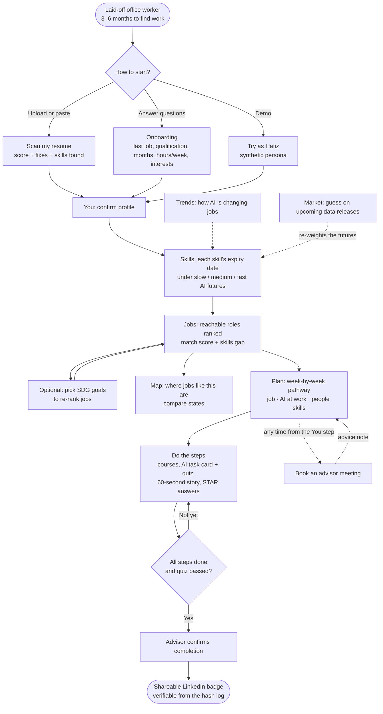
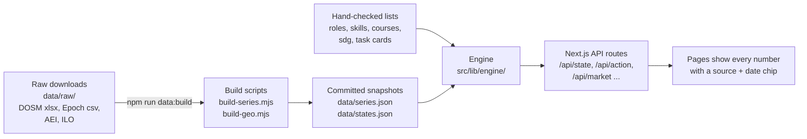

# Jobbery

**A deadline-based job plan for young office workers who have just been laid off.**

SDC Hackathon 2026 · Domain 1: Aiversecity Future-Ready Workforce · Licence: Apache-2.0

> The app's code lives in [`runway/`](runway/) (Runway was the working name). For setup, the advisor passcode and a judge's walkthrough, see [`runway/README.md`](runway/README.md).

---

## Contents

1. [Summary](#1-summary)
2. [How it is human-centred](#2-how-it-is-human-centred)
3. [User flow](#3-user-flow)
4. [Data: where it comes from and how it gets into the app](#4-data-where-it-comes-from-and-how-it-gets-into-the-app)
5. [Future-role matching and skills gap](#5-future-role-matching-and-skills-gap)
6. [Personalised reskilling pathway](#6-personalised-reskilling-pathway)
7. [SDG mapping](#7-sdg-mapping)
8. [Handling uncertainty: how the forecasting works](#8-handling-uncertainty-how-the-forecasting-works)
9. [Job map and moving for work](#9-job-map-and-moving-for-work)
10. [Advisor meetings](#10-advisor-meetings)
11. [Learner motivation](#11-learner-motivation)
12. [Fairness check](#12-fairness-check)
13. [Coming next: inclusive design and automatic re-planning](#13-coming-next)
14. [Tech stack](#14-tech-stack)
15. [Run it](#15-run-it)

---

## 1. Summary

**The problem.** 2026 is on track to be Malaysia's worst year for retrenchments since the pandemic, and white-collar workers have been hit hardest. A laid-off worker gets 3 to 6 months of PERKESO Job Search Allowance. In that time they need to know which of their skills AI will soon do, which jobs are actually growing, and what to learn first. Most "AI job risk" tools give one fixed score from old research.

**What Jobbery does.**

| Step | What the worker gets |
|---|---|
| **Forecast** | Which skills and jobs are rising or falling, from public, dated data. Each skill gets an "expiry date". |
| **Match** | Jobs they can reach before their deadline, ranked with a score they can open up, and the skills they're missing. |
| **Plan** | A week-by-week plan with real free courses, AI-at-work practice and interview prep, every step tagged to a UN SDG. |

**What makes it different.** Forecasts aren't fixed. A **prediction market** (points only, never money) asks checkable questions about the next official data release. When the release comes out, the questions settle, and the futures that matched reality gain weight. Each worker's dates, job ranking and plan then update.

---

## 2. How it is human-centred

- **The worker decides.** Jobbery ranks options and explains them. It never picks a job for anyone, and there are no automated hiring decisions.
- **Built around a real deadline.** Every plan is measured against the months the worker says they have and the hours a week they can study.
- **A person to ask, on the worker's terms.** The worker can book a meeting with an advisor whenever they want one. Nothing waits on an advisor's approval (see [section 10](#10-advisor-meetings)).
- **Every number shows its source.** Each forecast, demand figure and course has a source and date chip. Explanations are filled in from templates, so the app can't invent jobs, courses or statistics.
- **Plain language.** Pages are written for someone who has never read a chart like these: "about 14 in every 100 job ads", not "14.2% share".
- **Private by default.** A scanned resume is read in memory and never stored. Only the score, the fixes and the skill IDs are kept.
- **No AI model at run time.** Scores and plans are computed by tested, readable code (`runway/src/lib/engine/`), so the same inputs always give the same answer.

---

## 3. User flow



**Who uses it**

| User | Need |
|---|---|
| **Primary: laid-off worker**, 22–35, from finance or admin back-office work | To know which skills will last, which reachable jobs are growing, and what to learn each week |
| **Secondary: advisor**, for example an employment officer | To see the worker's profile and plan, give advice when asked, and confirm a finished pathway |
| **Forecasters** (simulated now, real people later) | To make checkable guesses about upcoming data and build a track record |

---

## 4. Data: where it comes from and how it gets into the app

### Sources

All data is public or synthetic. Every source is a **dated snapshot** saved in the repo.

| Source | What we take | Used for |
|---|---|---|
| **DOSM Job Market Insights** (2026 Q2 release, 18 Aug 2026) | Online job ads by occupation group, each quarter | Job demand; settles market questions |
| **Epoch AI benchmarking data** (retrieved 20 Oct 2026, CC-BY) | Best AI test scores over time | How fast AI is improving; settles market questions; history replay |
| **Anthropic Economic Index** (release 2025-02-10, CC-BY) | Share of each occupation's tasks seen in real AI use | How fast AI is being adopted for each skill |
| **ILO 2025 GenAI exposure scores** (CC BY 4.0) | Exposure of each occupation (ISCO-08) to generative AI | How much of a skill AI could do |
| **O\*NET** (CC BY 4.0) | Occupation codes and task lists | Role IDs for 89 roles; task cards |
| **OpenDOSM** | Employment by industry and state, unemployment (2026 Q2), median wages (2025) | The job map |
| **geoBoundaries** (OpenStreetMap, ODbL) | State boundaries | Drawing the map |
| **UN SDG target text** (sdgs.un.org) | Official wording of each target | SDG tags |
| **Course list** (97 hand-checked courses, each with a checked date and link status) | Khan Academy, Microsoft Learn, Coursera, Kaggle, freeCodeCamp, HRD Corp, PERKESO and others | The reskilling plan |
| **Synthetic** | Demo personas and about 200 simulated forecasters | Demo only, always labelled |

### How it gets into the app

We download source files instead of calling a live API. Government releases come out quarterly as workbooks, so a dated file is more reliable than an API, and anyone can check exactly what the app used.



### AI trend signal layer

This is the part that tracks AI progress and turns it into skill and job signals.

| Signal | From | What the worker sees |
|---|---|---|
| **Capability:** how fast AI is getting better | Epoch AI benchmark scores, by quarter | "How AI is changing jobs" chart on **Trends** |
| **Adoption:** how much AI is actually used for a task | Anthropic Economic Index task coverage | Feeds each skill's expiry date |
| **Exposure:** how much of an occupation's work AI could do | ILO 2025 exposure scores | Bands: "AI can do a lot / some / little of this work" |
| **Hiring:** which job groups are hired more or less | DOSM online job ads, by quarter | Office admin share of ads; demand per job group |

These four signals combine into a **skill expiry date**: the year AI is expected to do most of the work behind a skill *and* be in common use for it (see [section 8](#8-handling-uncertainty-how-the-forecasting-works)).

### Can it be updated? Yes.

1. Put the newer DOSM workbook (or Epoch export) in `runway/data/raw/`.
2. Change the cut-off dates in `scripts/build-series.mjs` and `src/lib/engine/questions.ts`.
3. Run `npm run data:build`.

When the new data loads, open market questions settle against it, the futures are re-weighted, and every worker's expiry dates, job ranking and plan are recomputed. A "what changed and why" panel lists each change with its source. The next scheduled releases are **DOSM Jul–Sep 2026 (17 Nov 2026)** and **Epoch AI Oct–Dec 2026 (Jan 2027)**.

---

## 5. Future-role matching and skills gap

Jobbery has **89 roles in 10 sectors** and **80 skills**. Each role lists the skills it needs, each weighted by importance (1–3), plus the qualification it requires.

### The match score

Every role gets a score from five parts. The worker can open the score and see each part.

| Part | Weight | What it measures |
|---|---|---|
| **Skill overlap** | 25% | How much of the role's skill list (weighted by importance) the worker already has |
| **Future outlook** | 30% | How long the role's skills are expected to last before AI does most of the work |
| **Job demand** | 20% | Whether DOSM job ads for this job group are rising or falling |
| **Reachable in time** | 15% | How much room the plan leaves before the worker's deadline |
| **Interests and field** | 10% | Fit with the worker's interests and their last job's sector |

Adjustments:
- **Skills at risk:** a role whose skills mostly expire soon loses up to 8 points.
- **Few jobs nearby:** if the worker says where they can work, a role that is scarce there loses up to 6 points. It is moved down, never hidden.
- **SDG goal bonus:** +12 points if the role serves a goal the worker picked.

### Which roles are ranked

- **Only reachable roles are ranked.** Reachable means the plan's weeks fit within the worker's deadline (months × 4.345, minus 2 weeks of slack).
- **Qualification check:** roles that need more than the worker's highest qualification (SPM, diploma, degree...) aren't ranked. They're listed as longer-term paths.

### The skills gap

For each role, the gap is the list of skills the worker doesn't have yet. Each missing skill shows:
- its importance to the role
- its expiry date under each future
- the course that will cover it

The more skills the worker already has, the fewer weeks of practice the role needs. So a civil engineer is matched to civil engineering, not to something unrelated.

---

## 6. Personalised reskilling pathway

The plan is built from the chosen role's skills gap, the worker's **hours per week** and their **deadline**.

### How courses are chosen

1. Take the missing skills.
2. Pick the hand-checked free course that covers the most missing skills per hour (a greedy cover).
3. Repeat until every skill is covered. A skill with no checked course gets a 20-hour HRD Corp e-LATiH placeholder, clearly marked. Jobbery never invents a course.
4. **Weeks for a step = course hours ÷ hours per week**, rounded up. Steps run one after another, so the plan shows real calendar weeks.

The worker can **swap a course** for another one that covers the same skills, where one exists.

### Three strands

| Strand | Steps | Estimated time |
|---|---|---|
| **People** | Rewrite your resume (from the resume scan) | 2 h, week 1 |
| **Job** | Gap courses, e.g. Khan Academy, Microsoft Learn, Coursera, Kaggle, freeCodeCamp, HRD Corp | From each course's listed hours |
| **AI at work** | **AI task card:** *Ask* (write a prompt for a real task) → *Check* (a quiz: find 3 planted mistakes in a sample AI answer) → *Hand off* (a reusable prompt + a "how I do this task" sheet) | 4–6 h |
| **People** | Your story in 60 seconds | 1 h |
| **People** | Prepared answers using STAR (Situation, Task, Action, Result), including "a time you caught a mistake" | 3 h |
| **People** | Rehearse, then a mock interview with an advisor | 2 h |
| **Job** | Apply for roles | Final weeks |

**Example (synthetic):** Hafiz, 27, a bank operations executive, has 5 months and 10 hours a week. His plan lists every step with a date range, hours, cost (free) and funding label (*Free*, *PERKESO training support* or *HRD Corp once re-employed*).

The task card, quiz answers, prompt and sheet become a **portfolio** the worker can show an employer. The finance task card (monthly budget variance report, from the O\*NET budget analyst task list) is written in full. Cards for the other sectors come in the final round.

**Plan types:** *switch* (train for a new job), *bridge* (keep the current job for income while training), *reshape* (stay in the job and add the skills that keep it going).

---

## 7. SDG mapping

**Every role and every skill is tagged** with at least one UN SDG target. Each tag has a one-line reason and the official UN target text as its source.

| Example | SDG target | Why |
|---|---|---|
| Accountant (role) | **8.2** Productivity through technology | Accurate accounts help organisations run productively |
| AML and compliance analyst (role) | **16.4** Fight illicit financial flows | Catches money laundering |
| ESG reporting assistant (role) | **12.6** Sustainability reporting | Helps companies report their impact |
| Healthcare claims administrator (role) | **3.8** Universal health coverage | Keeps claims moving for patients |
| Microfinance officer (role) | **8.10** Access to financial services | Brings credit to small businesses |
| Data entry (skill) | **8.5** Decent work for all | Reskilling away from routine work protects employment |

### SDGs change choices, not just labels

- **A goal picker re-ranks jobs.** The worker picks the goals they care about. Matching roles get a bonus, and the trade-off is shown, e.g. "+3 weeks of training, but this role fights financial crime (SDG 16.4)".
- **Every plan step shows its SDG**, taken from the skill it teaches.
- **A two-layer summary shows how the career path contributes:**
  - *By reskilling, you advance* **4.4** (relevant skills for decent jobs) and **8.5** (full employment).
  - *Your new job serves* the role's own target, e.g. **12.6**.

Jobbery itself works toward **4.3, 4.4, 8.5, 8.6** (youth not in employment), **1.3** (social protection) and **10.2** (inclusion).

---

## 8. Handling uncertainty: how the forecasting works

Nobody knows how fast AI will progress, so Jobbery doesn't give one forecast. It works with **three futures**, and a prediction market decides how likely each one is.

### Three futures

| Future | AI benchmark pace | Adoption speed | Office admin job ads |
|---|---|---|---|
| **Slow** | 60% of the recent pace | 0.6× | −0.05 points a quarter |
| **Medium** | Recent pace continues | 1.0× | −0.15 points a quarter |
| **Fast** | 160% of the recent pace | 1.6× | −0.35 points a quarter |

### Skill expiry dates

For each skill and each future:

```
readiness(year) = exposure × adoption(year)
exposure        = ILO exposure score of the skill's occupation
adoption(year)  = 1 − e^(−rate × speed × years),   rate = 0.15 + 0.6 × Economic Index task coverage
expiry year     = the first year readiness reaches 0.45
```

The date shown is the average of the three futures, weighted by how likely each one is. Skills that stay below the threshold in every future are marked **lasting**, e.g. people skills.

### The prediction market

1. **Questions are checkable.** For example: "Will clerical job ads rise by more than 3 points in the next DOSM release?" Each question has three strike levels, and each is a Yes/No market priced by an LMSR (logarithmic market scoring rule) market maker.
2. **Each future makes a prediction** for every question.
3. **When the real data comes out**, questions settle. Futures that predicted well gain weight (at half strength, with older quarters fading). Open questions tilt the weights a little using the crowd's current price.
4. **No future drops below 5%**, so no future is ever ruled out.
5. **Forecasters are scored with the Brier score.** Influence moves to the most accurate ones.
6. **About 200 simulated forecasters** (always labelled) earned track records by replaying real past releases. Judges and users can make guesses too, and each question shows what a Yes or No would change ("If Yes: data entry expires around Nov 2029").

### Being honest about it

- In the replay of real past releases, the market only just beats a coin flip (Brier 0.242 vs 0.25). One quarter's change is hard to call. The market's main job is to **score the futures in public against official numbers**.
- The crowd's forecasts for open questions are **hashed into the repo before the data comes out** (`runway/anchors/`), so nobody, including us, can change them afterwards.
- Every screen shows "these are estimates, not certainties", and the worker can set the future weights themselves.
- **Points only, never money.** Gambling law, Muslim users and financially vulnerable users all rule out real money.

---

## 9. Job map and moving for work

The **Map** page shows, state by state, where jobs like the one the worker picked are found. The map of Malaysia can be dragged and zoomed, with quick views for all of Malaysia, Peninsular Malaysia, Sabah and Sarawak.

- **Colour the map by:** jobs like this · unemployment rate · median pay.
- **Each state's figures:** an estimated number of jobs like this, median monthly pay, unemployment rate.
- **"Would you move for work?"** Pick your state, then any other state to compare: "*Selangor has 5.3× as many jobs like this as Kedah*", pay RM X higher or lower a month, unemployment Y points higher or lower.
- **A note on cost of living:** higher pay often comes with higher rent. The page suggests talking a move through with an advisor. Jobbery shows the figures; it doesn't tell anyone where to live.
- **Matching:** your home state alone never changes your matches (a test checks this). Only if you say you won't move do jobs that are scarce in your area move down the ranking. They are never hidden.

Malaysia publishes no open data on job ads by state and occupation. So "jobs like this" is an estimate from DOSM employment by industry and state, scaled to 2026 Q2, and it's labelled as one.

---

## 10. Advisor meetings

A worker can **book a meeting with an advisor**. It is optional, and nothing in the app waits on it.

**Worker side: "Meet an advisor" (`/advisor`)**
- A two-week calendar of 30-minute slots in Malaysia time, pooled across all advisors.
- Pick a slot and a topic (which job to aim for, courses and what they cost, fitting it into my time, interviews and applications, or something else), then write a question.
- Can be booked from the first step. A plan isn't required.
- One upcoming booking at a time. Either side can cancel, and the advisor gives a reason.
- A **Demo advisor** always has weekday slots, so the calendar is never empty.

**Advisor side: "Advisor view"**, with three tabs:

| Tab | What the advisor does |
|---|---|
| **Upcoming meetings** | Sees the worker's question, profile, top jobs, plan and the futures behind the advice. Writes a note, which appears on the worker's Plan page. |
| **Pathways to confirm** | Confirms a finished pathway. This is the only sign-off, and only then is the LinkedIn badge issued. |
| **My free times** | Opens or closes half-hour slots on a 14-day grid. |

The hash log records "advice given", the advisor's ID and a **hash of the note, not the note itself**.

---

## 11. Learner motivation

- **A visible runway.** A progress strip shows the weeks of the plan against the worker's deadline, so they always know where they stand.
- **Badges as they go:** one for each finished step (e.g. "Spreadsheets + Data analysis", "AI checker", "Resume ready"), plus milestones: *First step*, *Halfway*, *Every step done*. These are self-reported and labelled as such.
- **Real evidence, not just ticks.** The AI task card, quiz, 60-second story and STAR answers complete only when the work is saved, and they build a portfolio.
- **A verified LinkedIn badge** at the end, confirmed by an advisor and checkable by anyone at `/badge/[id]` against the hash log. The badge says "pathway completed", never "certified".
- **The market leaderboard.** Forecasters earn an accuracy score, a rank and influence.

---

## 12. Fairness check

- **Age, gender and background are never inputs.** Matching accepts only a whitelisted input type (`pickInputs`): skills, months, hours, interests, goals, qualification, field and area.
- **A test proves it.** The same skills with a different age or gender give exactly the same matches. Another test checks that the worker's home state alone never changes their matches.
- **The check runs live** on the **Trust** page (`/trust`, via `/api/fairness`), along with hash-chain verification and the full list of data sources.
- **Tamper-evident log.** Every guess, settlement, advice note and badge is added to a hash-chained log. Its fingerprint is committed to this repo (`npm run anchor`).
- **Labelled simulations.** Simulated forecasters and demo personas are always marked as made up. No real CVs or personal data are used.

---

## 13. Coming next

### Inclusive design

- **Bahasa Malaysia and Chinese** versions of the interface.
- **Accessibility:** a full screen-reader and keyboard pass, larger text and high-contrast options, and plain-language reading level checks on every page.
- **Low-bandwidth mode** for older phones and patchy mobile data.
- **More starting points:** task cards for the other nine sectors, so workers outside finance get the same AI-at-work practice.

### Automatic re-planning

Today, the plan is rebuilt when the worker changes their job, hours or course choice, or when new data moves the futures. Next, it will re-plan on its own when life gets in the way:

- **Falling behind:** if steps run late, the remaining steps are rescheduled to the deadline, and the app says plainly whether the job is still reachable.
- **Running out of time:** if the deadline can no longer be met, it suggests a shorter route (a bridge plan or a closer role) for the worker to choose.
- **New data:** when a release shortens a skill's expiry date, the steps for that skill move up or are swapped, and the "what changed and why" panel explains it.

The worker always confirms a new plan before it replaces the old one.

---

## 14. Tech stack

| Layer | What we use |
|---|---|
| **Framework** | Next.js 16 (App Router), React 19, TypeScript |
| **Styling and motion** | Tailwind CSS 4, Framer Motion, Lucide icons |
| **Charts and map** | Recharts; a hand-drawn SVG map of Malaysia from geoBoundaries (no third-party base map) |
| **Engine** | Pure TypeScript in `src/lib/engine/`: LMSR market, simulated forecasters, history replay, futures weights, expiry dates, matching, planning |
| **Storage** | PostgreSQL on Replit (`pg`); SQLite (`better-sqlite3`) when running locally |
| **Sessions and trust** | Signed session cookie; SHA-256 hash-chained log, with its fingerprint committed to Git |
| **Resume scan** | `unpdf` (PDF) and `mammoth` (Word), with rule-based scoring. No AI model. |
| **Data pipeline** | Node scripts (`build-series.mjs`, `build-geo.mjs`) turn raw downloads into committed JSON snapshots |
| **Tests** | Vitest: fairness, LMSR, futures weights, replay, matching, planning, log |
| **Hosting** | Replit. No GPU needed. |

---

## 15. Run it

```bash
cd runway
npm install
npm run dev
```

The app runs at http://localhost:3000. Other commands:

| Command | What it does |
|---|---|
| `npm test` | Runs the engine tests |
| `npm run typecheck` | Checks types |
| `npm run data:build` | Rebuilds data snapshots from `data/raw/` |
| `npm run anchor` | Writes the hash log's fingerprint to `anchors/` |

Without `DATABASE_URL`, sessions are kept in `.data/runway.db` (SQLite). On Replit, set `DATABASE_URL` to the built-in Postgres and `SESSION_SECRET` to a random string.

For the advisor passcode and a judge's walkthrough, see [`runway/README.md`](runway/README.md).
