# Jobbery

**A deadline-based career plan for fresh graduates and everyone in the workforce.**

SDC Hackathon 2026 · Domain 1: Aiversecity Future-Ready Workforce · Licence: Apache-2.0

## Team information

| Field | Details |
|---|---|
| **Team name** | #slaynergy |
| **Team domain** | Domain 1: Aiversecity Future-Ready Workforce |
| **Team leader** | Yang Zi Chien |
| **University** | Xiamen University Malaysia |
| **Number of members** | 5 |

### Links

| Resource | Link or status |
|---|---|
| **GitHub repository** | https://github.com/yabgzichien/SDCHack-slaynergy |
| **Live demo** | https://sdc-runway.vercel.app/ |
| **RunPod endpoint** | Not used |
| **Slide deck** | [PDF](submission/Jobbery%20pitch%20deck.pdf) · [PowerPoint](submission/Jobbery%20pitch%20deck.pptx) |
| **Demo video** | https://www.youtube.com/watch?v=pRHKh5LNF-s |
| **Preliminary proposal** | [PDF](submission/SDC2026_slaynergy_Preliminary.pdf) |
| **Technical and tools declaration** | [PDF](submission/SDC2026_slaynergy_TechDeclaration.pdf) |
| **Replit proof of use** | [PDF](submission/Replit%20Proof%20Of%20Use.pdf) |
| **How to run** | [Section 15](#15-run-it) |
| **Project structure** | [Section 16](#16-project-structure) |
| **Replit usage** | [Section 17](#17-how-we-used-replit-and-runpod) |

### Run locally

```bash
cd src
npm install
npm run dev
```

Open http://localhost:3000. See [section 15](#15-run-it) for tests and other commands.

> The app's code lives in [`src/`](src/). For setup, the advisor passcode and a judge's walkthrough, see [`src/README.md`](src/README.md).

---

## Contents

1. [Summary](#1-summary)
2. [How it is human-centred](#2-how-it-is-human-centred)
3. [User flow](#3-user-flow)
4. [Data: where it comes from and how it gets into the app](#4-data-where-it-comes-from-and-how-it-gets-into-the-app)
5. [Future-role matching and skills gap](#5-future-role-matching-and-skills-gap)
6. [Personalised reskilling pathway](#6-personalised-reskilling-pathway)
7. [SDG mapping](#7-sdg-mapping)
8. [Handling uncertainty: how the forecasting works](#8-handling-uncertainty-how-the-forecasting-works)
9. [Job map and moving for work](#9-job-map-and-moving-for-work)
10. [Advisor meetings](#10-advisor-meetings)
11. [Learner motivation](#11-learner-motivation)
12. [Fairness check](#12-fairness-check)
13. [Coming next: inclusive design and automatic re-planning](#13-coming-next)
14. [Tech stack](#14-tech-stack)
15. [Run it](#15-run-it)
16. [Project structure](#16-project-structure)
17. [How we used Replit and RunPod](#17-how-we-used-replit-and-runpod)
18. [How we use AI](#18-how-we-use-ai)

---

## 1. Summary

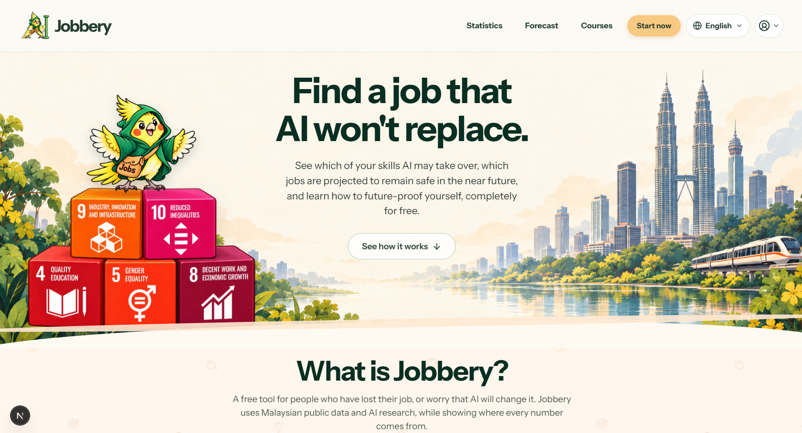

*The landing page introduces Jobbery and the path from skills to jobs and learning.*

**The problem.** Fresh graduates need a path into their first job, while people already in the workforce need ways to develop their skills, change careers, return to work or find a new role after job loss. They need to understand how AI may change their skills, which jobs are growing, and what to learn first. Jobbery helps them plan around their own career goals, available study time and chosen deadline. Most "AI job risk" tools give one fixed score from old research.

**What Jobbery does.**

| Step | What the user gets |
|---|---|
| **Forecast** | Which skills and jobs are rising or falling, from public, dated data. Each skill gets an "expiry date". |
| **Match** | Jobs they can reach before their deadline, ranked with a score they can open up, and the skills they're missing. |
| **Plan** | A week-by-week plan with real free courses, AI-at-work practice and interview prep, every step tagged to a UN SDG. |

**What makes it different.** Forecasts aren't fixed. A **prediction market** (points only, never money) asks checkable questions about the next official data release. When the release comes out, the questions settle, and the futures that matched reality gain weight. Each user's dates, job ranking and plan then update.

---

## 2. How it is human-centred

- **The user decides.** Jobbery ranks options and explains them. It never picks a job for anyone, and there are no automated hiring decisions.
- **Built around a real deadline.** Every plan is measured against the months the user says they have and the hours a week they can study.
- **A person to ask, on the user's terms.** The user can book a meeting with an advisor whenever they want one. Nothing waits on an advisor's approval (see [section 10](#10-advisor-meetings)).
- **Every number shows its source.** Each forecast, demand figure and course has a source and date chip. Explanations are filled in from templates, so the app can't invent jobs, courses or statistics.
- **Plain language.** Pages are written for someone who has never read a chart like these: "about 14 in every 100 job ads", not "14.2% share".
- **Multilingual interface.** Already available in English, Bahasa Malaysia, Chinese and Tamil. Use the language picker in the header to switch languages.
- **Private by default.** A scanned resume is read in memory and never stored. If the user leaves AI on, the text is also sent once to the Groq API to read it. Only the score, the fixes and the skill IDs are kept.
- **AI suggests, the user decides.** The one GenAI feature is an optional resume reader (Qwen3.8 27B on the Groq API). It proposes extra skills, each quoting the resume line it is based on, and better wording for weak lines. The user accepts or rejects every suggestion. Server checks drop any skill that is not on Jobbery's list or not backed by a real line, and any rewrite that adds a number the original line does not have. Scores, forecasts, matching and plans are computed by tested, readable code (`src/src/lib/engine/`), so the same inputs always give the same answer.

---

## 3. User flow

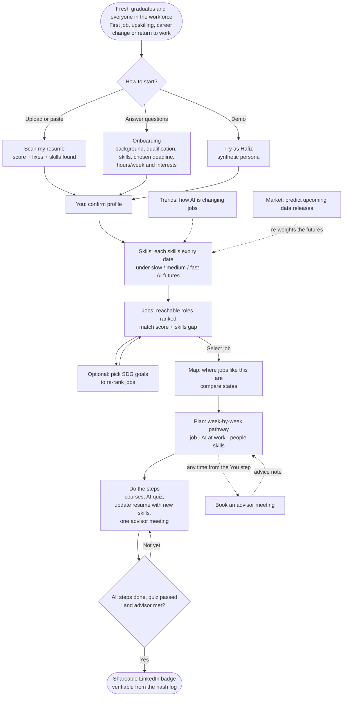

**Who uses it**

| User | Need |
|---|---|
| **Fresh graduates** entering the workforce | To understand their skills, explore reachable first jobs and build a weekly learning plan |
| **Everyone in the workforce**, including employed people, career changers, jobseekers and people returning to work | To keep skills relevant, explore growing roles and plan their next career step around their own deadline |
| **Secondary: advisor**, for example an employment officer | To meet each user once (a mock interview, advice, or anything else they ask), seeing their profile and plan |
| **Forecasters** (simulated now, real people later) | To make checkable predictions about upcoming data and build a track record |

---

## 4. Data: where it comes from and how it gets into the app

### Sources

All data is public or synthetic. Every source is a **dated snapshot** saved in the repo.

| Source | What we take | Used for |
|---|---|---|
| **DOSM Job Market Insights** (2026 Q2 release, 18 Aug 2026) | Online job ads by occupation group, each quarter | Job demand; settles market questions |
| **Epoch AI benchmarking data** (retrieved 20 Oct 2026, CC-BY) | Best AI test scores over time | How fast AI is improving; settles market questions; history replay |
| **Anthropic Economic Index** (release 2025-02-10, CC-BY) | Share of each occupation's tasks seen in real AI use | How fast AI is being adopted for each skill |
| **ILO 2025 GenAI exposure scores** (CC BY 4.0) | Exposure of each occupation (ISCO-08) to generative AI | How much of a skill AI could do |
| **O\*NET** (CC BY 4.0) | Occupation codes and task lists | Role IDs for 89 roles; task cards |
| **OpenDOSM** | Employment by industry and state, unemployment (2026 Q2), median wages (2025) | The job map |
| **geoBoundaries** (OpenStreetMap, ODbL) | State boundaries | Drawing the map |
| **UN SDG target text** (sdgs.un.org) | Official wording of each target | SDG tags |
| **Course list** (97 hand-checked courses, each with a checked date and link status) | Khan Academy, Microsoft Learn, Coursera, Kaggle, freeCodeCamp, HRD Corp, PERKESO and others | The reskilling plan |
| **Synthetic** | Demo personas and about 200 simulated forecasters | Demo only, always labelled |

### How it gets into the app

The server downloads the public source files itself and keeps each version as a numbered, hashed snapshot. Government releases come out quarterly as workbooks, so a dated file is more reliable than an API, and anyone can check exactly which data a prediction was settled on.

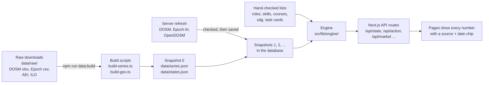

### AI trend signal layer

This is the part that tracks AI progress and turns it into skill and job signals.

| Signal | From | What the user sees |
|---|---|---|
| **Capability:** how fast AI is getting better | Epoch AI benchmark scores, by quarter | "How AI is changing jobs" chart on **Trends** |
| **Adoption:** how much AI is actually used for a task | Anthropic Economic Index task coverage | Feeds each skill's expiry date |
| **Exposure:** how much of an occupation's work AI could do | ILO 2025 exposure scores | Bands: "AI can do a lot / some / little of this work" |
| **Hiring:** which job groups are hired more or less | DOSM online job ads, by quarter | Office admin share of ads; demand per job group |

These four signals combine into a **skill expiry date**: the year AI is expected to do most of the work behind a skill *and* be in common use for it (see [section 8](#8-handling-uncertainty-how-the-forecasting-works)).

### Does it update? Yes, automatically.

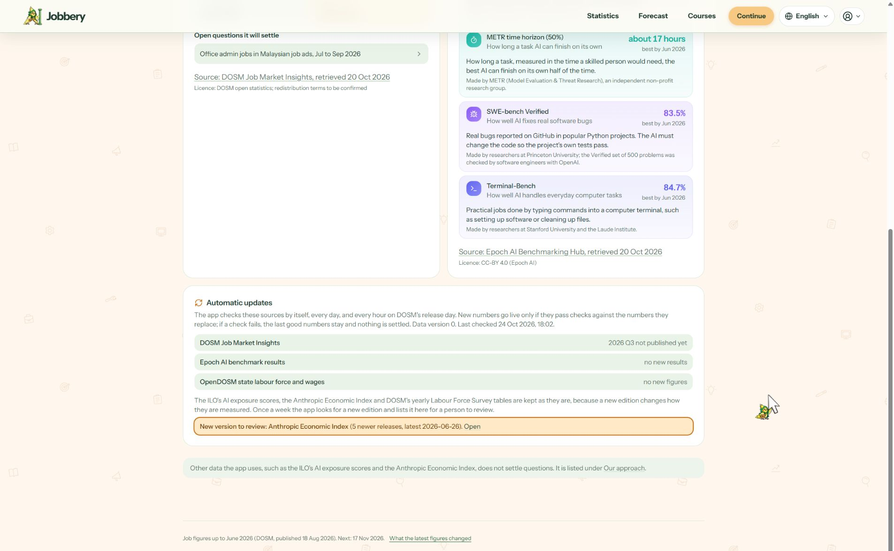

*The Sources page shows automatic checks, the active data version, source results and review alerts.*

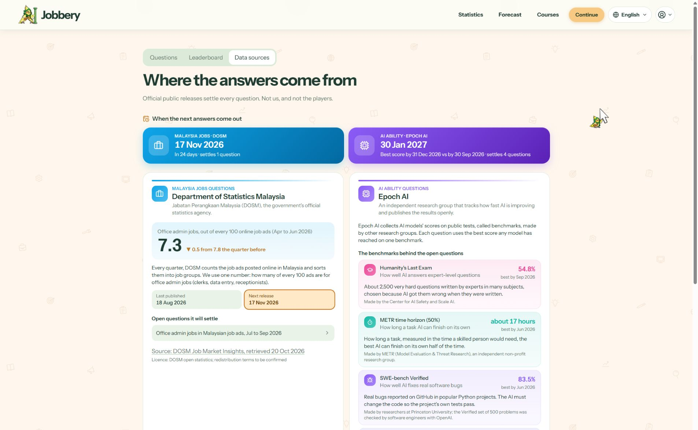

*Official source cards show the latest figures and when the next releases are due.*

When someone uses the app and the last check is old enough, the server checks for new data in the background:
- **How often:** daily, and hourly around DOSM's release day.
- **Updated automatically:** DOSM Job Market Insights, Epoch AI benchmark results, and OpenDOSM's state labour force and wages.
- **Checked first:** new numbers must pass checks against the numbers they replace. If a check fails, the last good data stays and nothing settles.
- **Pinned, alert only:** the ILO exposure scores, the Anthropic Economic Index and DOSM's yearly Labour Force Survey tables. A new edition changes how they are measured, so the Sources page flags it for a person to review.

When new data goes live:
- Open questions whose answers are in settle, and settlements are final.
  - DOSM questions settle when the release arrives.
  - Epoch AI questions settle 30 days after their quarter ends, once late benchmark results are in.
- The futures are re-weighted, and every user's expiry dates, job ranking and plan are recomputed.
- A "what changed and why" panel lists each change with its source.
- The snapshot's hash goes into the tamper-evident log.

The next releases are **DOSM Jul–Sep 2026 (17 Nov 2026)** and **Epoch AI Oct–Dec 2026 (checked from 30 Jan 2027)**. Details: [src/README.md](src/README.md#data-and-updating).

### History: see the app as it stood on any past release

**History** in the header opens a timeline with one stop per real DOSM Job Market Insights release: 2025 Q3 (published 28 Apr 2026), 2025 Q4 (25 May 2026), 2026 Q1 (25 Jun 2026) and today's 2026 Q2 (18 Aug 2026), with 2026 Q3 (17 Nov 2026) greyed out as not published yet. Each date was read from that edition's own page on dosm.gov.my.

- **Picking an earlier release redraws the app as of that day.** The radar, skill dates, job ranking, plan and forecast weights all use only what was public by then: DOSM quarters published by that day, Epoch AI results settled by it, and forecast weights replayed from the answers public by it. Skill dates are counted from that day. Today's ILO and Anthropic Economic Index scores are used, and DOSM figures are as DOSM publishes them today. A banner says so on every page, with **Back to today**.
- **What this release changed:** each stop lists what its figures changed against the stop before, with each line's source and date.
- **How the forecast has learned:** Slow / Medium / Fast bands above the stops show the forecast at each release (also as a table).
- **Read-only.** The timeline never settles, saves or changes anything. The picked release lives in the browser tab's memory only, so a reload returns to today. Predicting and profile changes are turned off while viewing the past. Engine: `src/src/lib/engine/history.ts` and `viewAsOf` in `view.ts`; API: `GET /api/history`; tests: `src/tests/history.test.ts`.

---

## 5. Future-role matching and skills gap

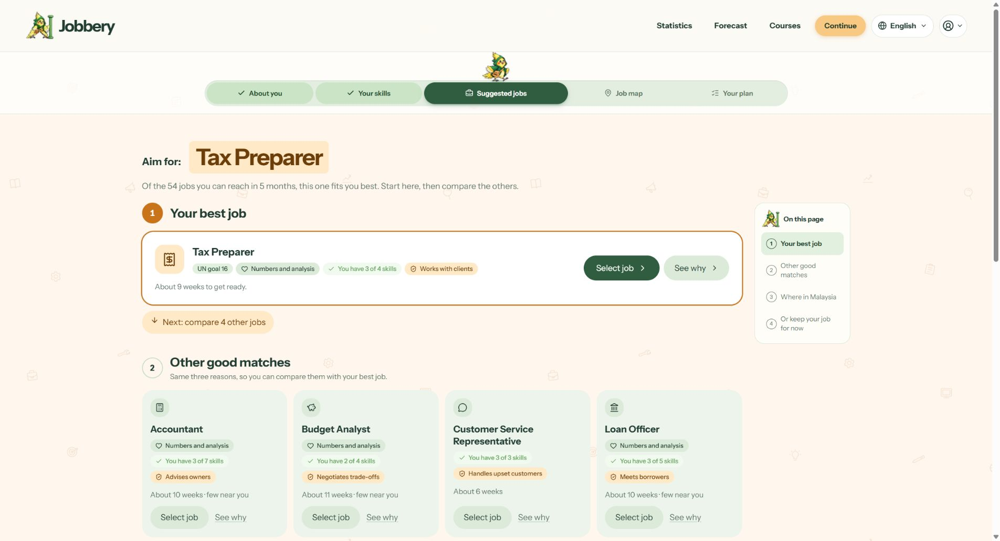

*Suggested jobs for the demo user, with skill overlap, reasons for the match and preparation time.*

Jobbery has **89 roles in 10 sectors** and **80 skills**. Each role lists the skills it needs, each weighted by importance (1–3), plus the qualification it requires.

### The match score

Every role gets a score from five parts. The user can open the score and see each part.

| Part | Weight | What it measures |
|---|---|---|
| **Skill overlap** | 25% | How much of the role's skill list (weighted by importance) the user already has |
| **Future outlook** | 30% | How long the role's skills are expected to last before AI does most of the work |
| **Job demand** | 20% | Whether DOSM job ads for this job group are rising or falling |
| **Reachable in time** | 15% | How much room the plan leaves before the user's deadline |
| **Interests and field** | 10% | Fit with the user's interests and their last job's sector |

Adjustments:
- **Skills at risk:** a role whose skills mostly expire soon loses up to 8 points.
- **Few jobs nearby:** if the user says where they can work, a role that is scarce there loses up to 6 points. It is moved down, never hidden.
- **SDG goal bonus:** +12 points if the role serves a goal the user picked.

### Which roles are ranked

- **Only reachable roles are ranked.** Reachable means the plan's weeks fit within the user's deadline (months × 4.345, minus 2 weeks of slack).
- **Qualification check:** roles that need more than the user's highest qualification (SPM, diploma, degree...) aren't ranked. They're listed as longer-term paths.

### The skills gap

For each role, the gap is the list of skills the user doesn't have yet. Each missing skill shows:
- its importance to the role
- its expiry date under each future
- the course that will cover it

The more skills the user already has, the fewer weeks of practice the role needs. So a civil engineer is matched to civil engineering, not to something unrelated.

### Why this job: the explanation the user sees

The Jobs page reads as three numbered stops: **① your best job → ② other good matches → ③ where in Malaysia**, with an amber highlight and a "Next: compare 4 other jobs" cue to guide a first-time user. Each job has its own icon, and every card shows the same three short reasons as chips:

| Reason | Built from |
|---|---|
| **Fits what you care about** | The interests the user picked that match the role, and whether it is in their field. If none match, it says so. |
| **Builds on what you know** | "You have 3 of 4 skills", and the skills still to add. |
| **Hard for AI to take over** | A one-line **human core** for each of the 89 roles (e.g. "Earning the trust of people new to banking, face to face"), with its O\*NET page as the source, then an honest split: what **AI will handle** (skills that fade, with dates) and what **stays yours** (lasting skills). |

**See why** opens the job page: the three reasons in full, the score breakdown, the skills gap, and **pay**. DOSM publishes no pay per job per state, so the page shows the national figure for the job's occupation group (DOSM Salaries & Wages Survey 2024: a median for managers, professionals and technicians, an average, labelled as such, for the other groups), next to all-user median pay by state.

**Select job** saves the choice and moves on to the Job Map. The map and the plan always follow the selected job, and switching jobs asks first if it would reset plan progress.

---

## 6. Personalised reskilling pathway

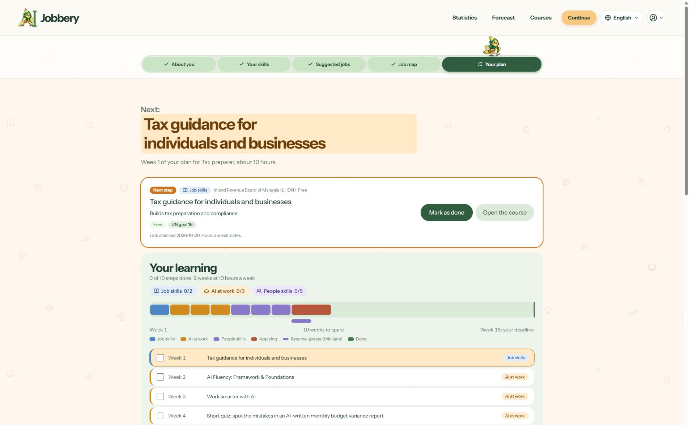

*The selected job becomes a learning pathway with a next step, weekly timeline and progress.*

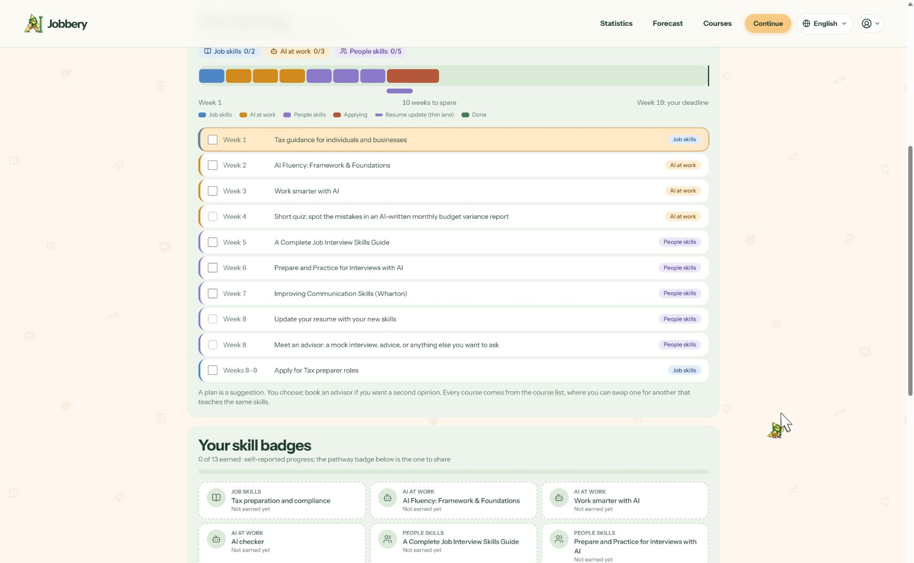

*The weekly timeline shows every course, practice task and application step.*

The plan is built from the chosen role's skills gap, the user's **hours per week** and their **deadline**.

### How courses are chosen

1. Take the missing skills.
2. Pick the hand-checked free course that covers the most missing skills per hour.
3. Repeat until every skill is covered. A skill with no checked course gets a 20-hour HRD Corp e-LATiH placeholder, clearly marked. Jobbery never invents a course.
4. **Weeks for a step = course hours ÷ hours per week**, rounded up. Steps run one after another, so the plan shows real calendar weeks.

The user can **swap a course** for another one that covers the same skills, where one exists.

### Three strands

Steps run in this order. Each strand has its own colour across the plan, the progress strip and the badges: **blue** job skills, **amber** AI at work, **purple** people skills.

| Strand | Steps | Estimated time |
|---|---|---|
| **Job** | Gap courses, e.g. Khan Academy, Microsoft Learn, Coursera, Kaggle, freeCodeCamp, HRD Corp | From each course's listed hours |
| **AI at work** | Free AI courses, then a **short quiz**: find the planted mistakes in a sample AI answer about a real task from the user's field. Optional portfolio piece: a reusable prompt + a "how I do this task" sheet | Course hours + 1 h |
| **People** | Free interview and workplace-communication courses | From each course's listed hours |
| **People** | **Update your resume with your new skills.** No new upload: the resume is rebuilt from the profile, the skills from the start-up resume scan, finished courses (marked *New*) and the portfolio piece, beside a checklist of the scan's fixes | 2 h |
| **People** | Meet an advisor (a mock interview, the resume, or anything else) | 1 h |
| **Job** | Apply for roles | Final weeks |

The resume update comes **after** the courses, so it can show the new skills, and **before** the advisor, who can review it.

**Example (synthetic):** Hafiz, 27, a bank operations executive, has 5 months and 10 hours a week. His plan lists every step with a date range, hours, cost (free) and funding label (*Free*, *PERKESO training support* or *HRD Corp once re-employed*).

The quiz result, prompt and sheet become a **portfolio** the user can show an employer (folded away on the Plan page until opened). The finance task card (monthly budget variance report, from the O\*NET budget analyst task list) is written in full. Cards for the other sectors come in the final round.

**Plan types:** *switch* (train for a new job), *bridge* (keep the current job for income while training), *reshape* (stay in the job and add the skills that keep it going).

---

## 7. SDG mapping

**Every role and every skill is tagged** with at least one UN SDG target. Each tag has a one-line reason and the official UN target text as its source.

| Example | SDG target | Why |
|---|---|---|
| Accountant (role) | **8.2** Productivity through technology | Accurate accounts help organisations run productively |
| AML and compliance analyst (role) | **16.4** Fight illicit financial flows | Catches money laundering |
| ESG reporting assistant (role) | **12.6** Sustainability reporting | Helps companies report their impact |
| Healthcare claims administrator (role) | **3.8** Universal health coverage | Keeps claims moving for patients |
| Microfinance officer (role) | **8.10** Access to financial services | Brings credit to small businesses |
| Data entry (skill) | **8.5** Decent work for all | Reskilling away from routine work protects employment |

### SDGs change choices, not just labels

- **A goal picker re-ranks jobs.** The user picks the goals they care about. Matching roles get a bonus, and the trade-off is shown, e.g. "+3 weeks of training, but this role fights financial crime (SDG 16.4)".
- **Every plan step shows its SDG**, taken from the skill it teaches.
- **The Plan page shows each goal as an official-colour UN SDG tile** with its target numbers and the official target text, nothing hidden, including the new job's own goal.
- **A two-layer summary shows how the career path contributes:**
  - *By reskilling, you advance* **4.4** (relevant skills for decent jobs) and **8.5** (full employment).
  - *Your new job serves* the role's own target, e.g. **12.6**.

Jobbery itself works toward **4.3, 4.4, 8.5, 8.6** (youth not in employment), **1.3** (social protection) and **10.2** (inclusion).

---

## 8. Handling uncertainty: how the forecasting works

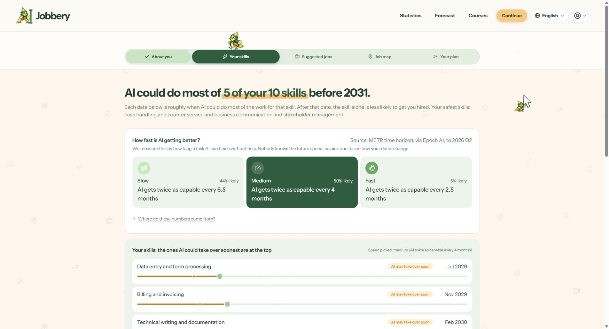

*The Skills page compares slow, medium and fast AI futures and shows estimated dates for each skill.*

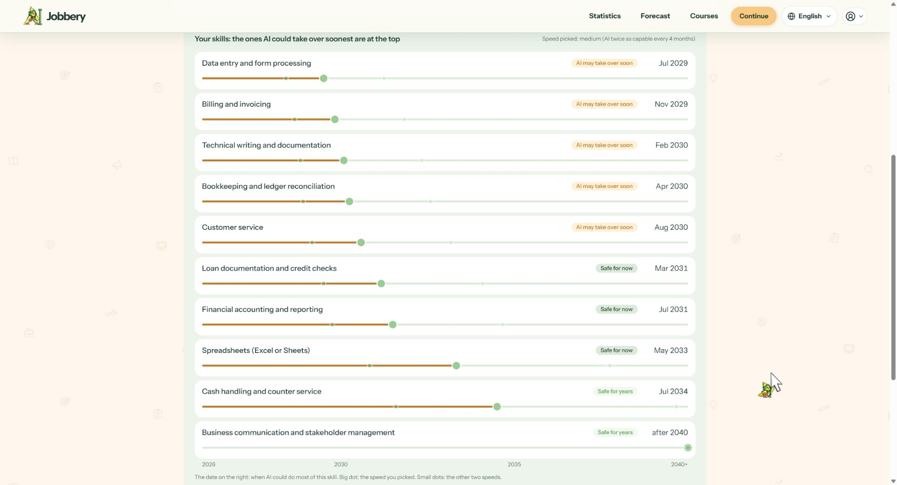

*The full skill list shows the estimated dates and which skills remain safer for longer.*

Nobody knows how fast AI will progress, so Jobbery doesn't give one forecast. It works with **three futures**, and a prediction market decides how likely each one is.

### Three futures

| Future | AI benchmark pace | Adoption speed | Office admin job ads |
|---|---|---|---|
| **Slow** | 60% of the recent pace | 0.6× | −0.05 points a quarter |
| **Medium** | Recent pace continues | 1.0× | −0.15 points a quarter |
| **Fast** | 160% of the recent pace | 1.6× | −0.35 points a quarter |

### Skill expiry dates

For each skill and each future:

```
readiness(year) = exposure × adoption(year)
exposure        = ILO exposure score of the skill's occupation
adoption(year)  = 1 − e^(−rate × speed × years),   rate = 0.15 + 0.6 × Economic Index task coverage
expiry year     = the first year readiness reaches 0.45
```

The date shown is the average of the three futures, weighted by how likely each one is. Skills that stay below the threshold in every future are marked **lasting**, e.g. people skills.

### The prediction market

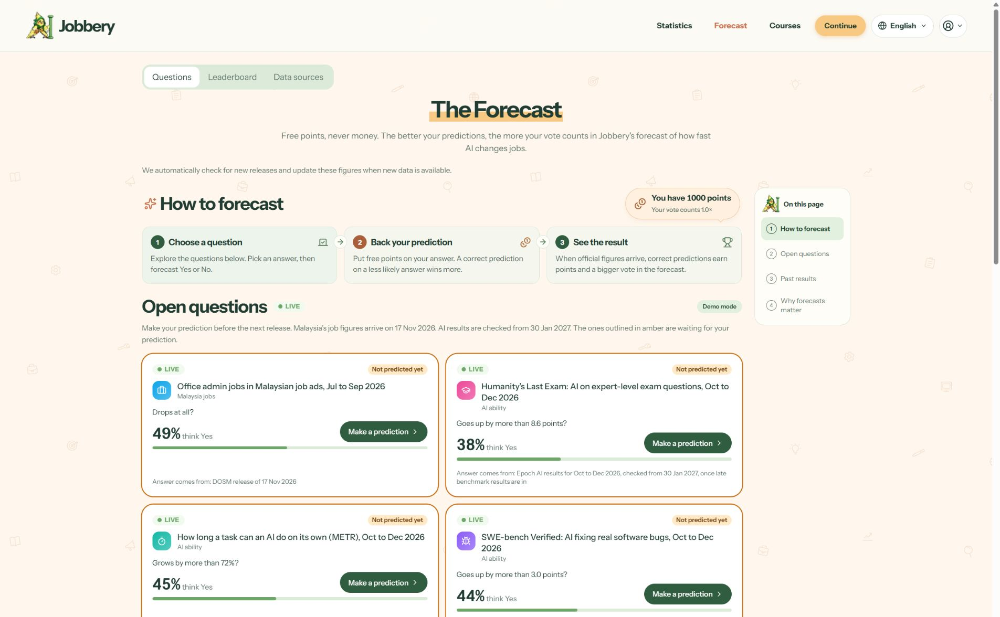

*The Forecast page explains points-based predictions and when upcoming data releases will settle the questions.*

1. **Questions are checkable.** For example: "Will clerical job ads rise by more than 3 points in the next DOSM release?" Each question has three strike levels, and each is a Yes/No market priced by an LMSR (logarithmic market scoring rule) market maker.
2. **Each future makes a prediction** for every question.
3. The app keeps three possible **AI futures**—slow, medium, and fast—and adjusts how much weight it gives each one.
4. **No future drops below 5%**, so no future is ever ruled out.
5. **Forecasters are scored with the Brier score.** Influence moves to the most accurate ones.
6. **About 200 simulated forecasters** (always labelled) earned track records by replaying real past releases. Judges and users can make predictions too, and each question shows what a Yes or No would change ("If Yes: data entry expires around Nov 2029").

### Being honest about it

- In the replay of real past releases, the market only just beats a coin flip (Brier 0.242 vs 0.25). One quarter's change is hard to call. The market's main job is to **score the futures in public against official numbers**.
- The crowd's forecasts for open questions are **hashed into the repo before the data comes out** (`src/anchors/`), so nobody, including us, can change them afterwards.
- Every screen shows "these are estimates, not certainties", and the user can switch between slow, medium and fast to see their dates under each. To disagree with the chances, they make a prediction on an open question, and that prediction is scored like everyone else's.
- **Points only, never money.** Gambling law, Muslim users and financially vulnerable users all rule out real money.

---

## 9. Job map and moving for work

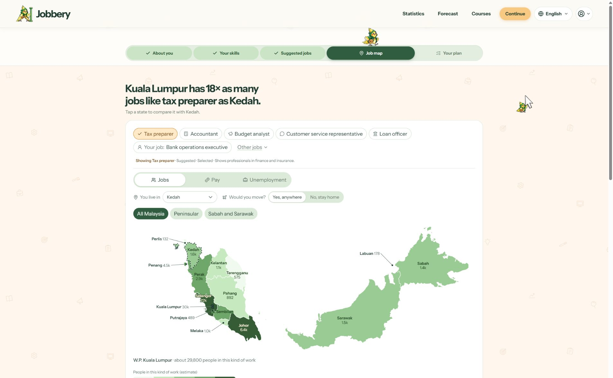

*The job map compares estimated employment, state median pay and unemployment across Malaysia.*

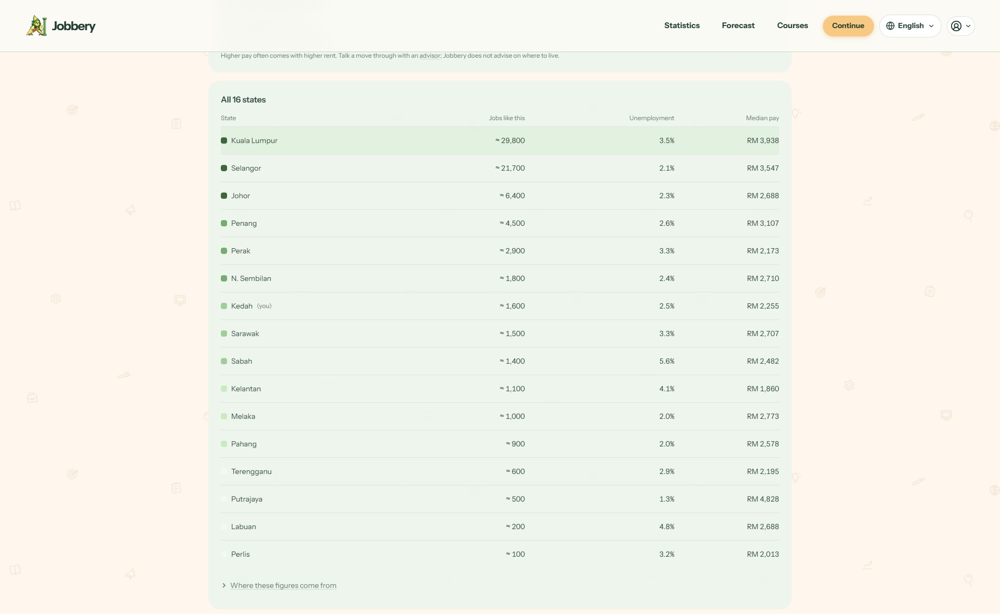

*The table below the map lists all 16 states with estimated jobs, unemployment and median pay.*

The **Map** page shows, state by state, where jobs like the one the user picked are found. The map of Malaysia can be dragged and zoomed, with quick views for all of Malaysia, Peninsular Malaysia, Sabah and Sarawak.

- **The map comes first.** Above it, a compact row of job pills: the user's **suggested** jobs, **their current job** (labelled), and **Other jobs**, a searchable list where every job is marked *Not suggested* (or *Not in reach yet*, preview only). The selected job is highlighted amber and a short "Showing … · Selected" line pulses when it changes.
- **Colour the map by:** jobs like this · unemployment rate · median pay.
- **All 16 states as a table** is always shown under the map.
- **Each state's figures:** an estimated number of jobs like this, median monthly pay, unemployment rate.
- **"Would you move for work?"** Pick your state, then any other state to compare: "*Selangor has 5.3× as many jobs like this as Kedah*", pay RM X higher or lower a month, unemployment Y points higher or lower.
- **A note on cost of living:** higher pay often comes with higher rent. The page suggests talking a move through with an advisor. Jobbery shows the figures; it doesn't tell anyone where to live.
- **Matching:** your home state alone never changes your matches (a test checks this). Only if you say you won't move do jobs that are scarce in your area move down the ranking. They are never hidden.

Malaysia publishes no open data on job ads by state and occupation. So "jobs like this" is an estimate from DOSM employment by industry and state, scaled to 2026 Q2, and it's labelled as one.

---

## 10. Advisor meetings

Every plan includes **one meeting with an advisor**, placed just before applying. The user chooses what it is for: a mock interview, the resume, advice, or anything else. **The plan step is ticked as soon as the meeting is booked** (and unticked if it is cancelled). The LinkedIn badge still needs the advisor's advice after the meeting. There is no separate sign-off: the human in the loop is the meeting.

**user side: "Meet an advisor" (`/advisor`)**
- A two-week calendar of 30-minute slots in Malaysia time, pooled across all advisors.
- Pick a slot and a topic (a mock interview, which job to aim for, courses and what they cost, fitting it into my time, interviews and applications, or something else), then write a question.
- Can be booked from the first step. A plan isn't required.
- One upcoming booking at a time. Either side can cancel, and the advisor gives a reason.
- A **Demo advisor** always has weekday slots, so the calendar is never empty.

**Advisor side: "Advisor view"** (`/counsellor`). Judges can sign in with one click as a demo advisor. A "needs you" strip at the top lists meetings still waiting for advice, with orange markers on anything waiting and green on what is done. Each meeting leads with the user, the job they are aiming for and their question; the date is a small line underneath. Their plan is shown as a timeline with an icon per step type. Two tabs:

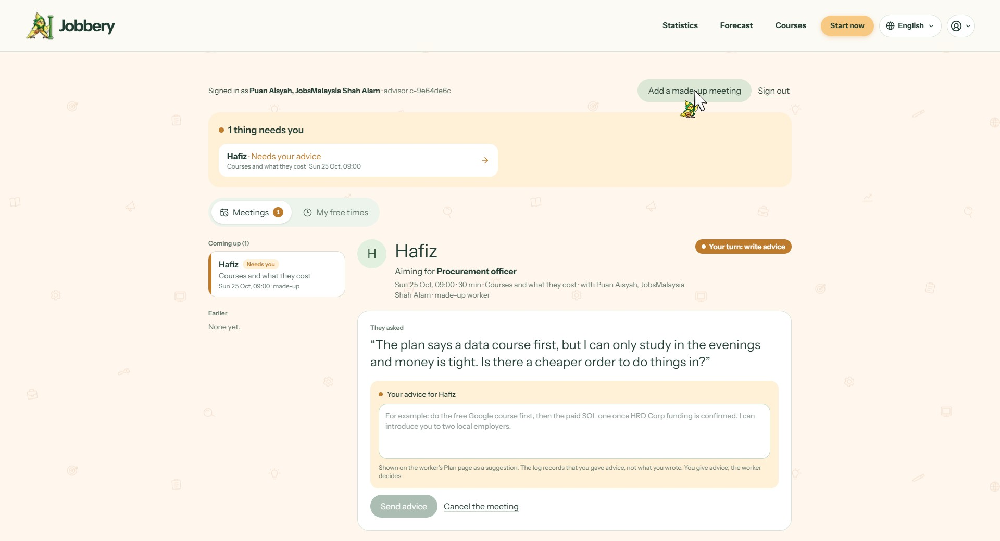

*The demo advisor sees a meeting that needs advice, the user's question and the advice form.*

| Tab | What the advisor does |
|---|---|
| **Meetings** | Sees the user's question, profile, top jobs, plan, the futures behind the advice, and **their resume drawn as a page** (rebuilt from their profile and finished steps, never the uploaded file). Writes advice, which appears on the user's Plan page. |
| **My free times** | Opens or closes half-hour slots on a 14-day grid. |

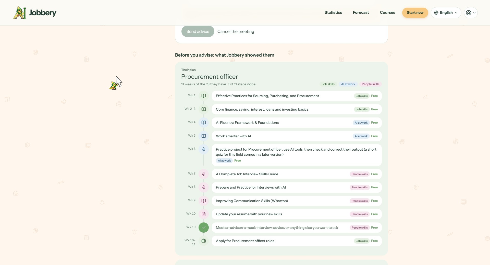

*The advisor can review every step of the user's learning plan before giving advice.*

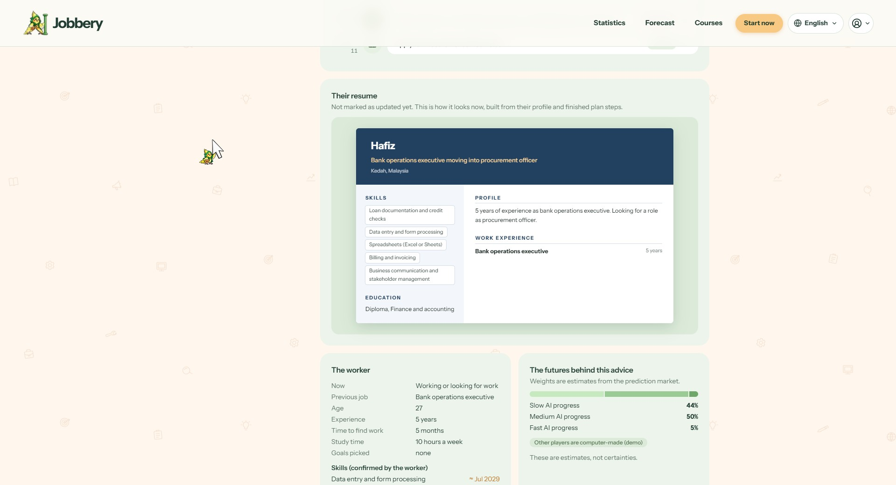

*The advisor sees the resume rebuilt from the demo profile and completed steps.*

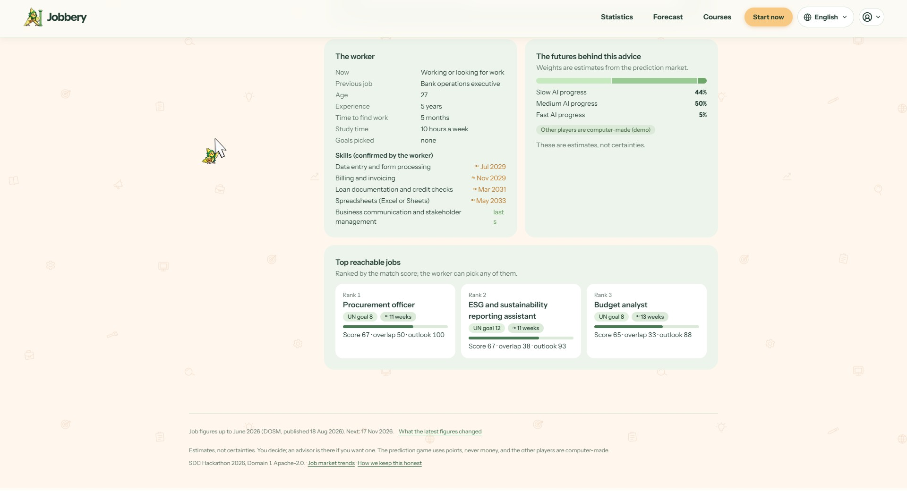

*The user's profile, forecast assumptions and top job matches are shown together.*

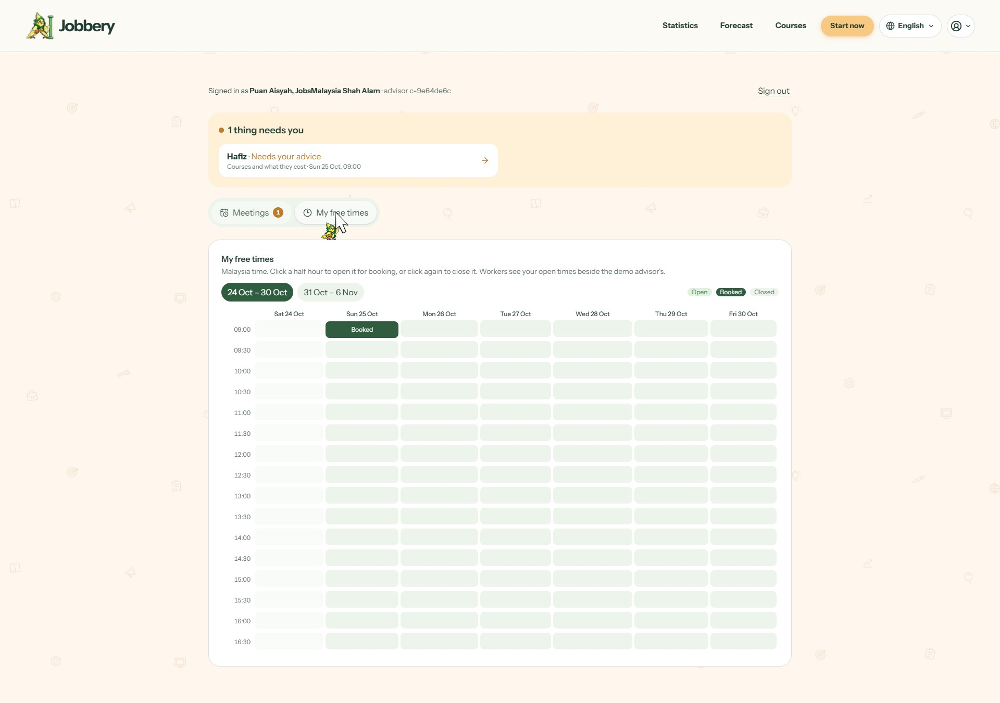

*The advisor opens or closes half-hour slots and can see booked times in the two-week calendar.*

The hash log records "advice given", the advisor's ID and a **hash of the note, not the note itself**.

---

## 11. Learner motivation

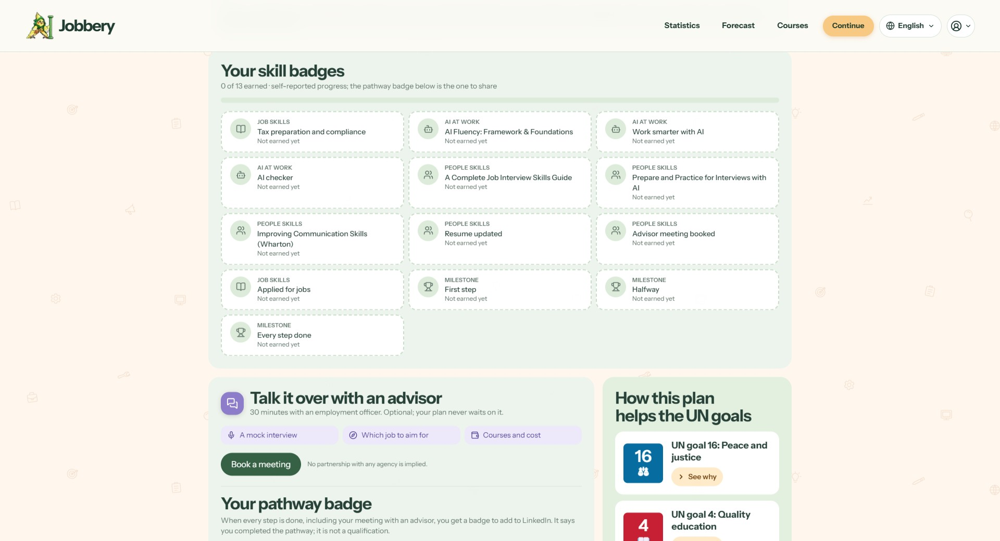

*The plan shows progress toward skill and milestone badges, the advisor meeting and the pathway badge.*

- **A visible timeline.** A progress strip shows the weeks of the plan against the user's deadline, so they always know where they stand.
- **Badges as they go:** one for each finished step (e.g. "Tax preparation and compliance", "AI checker", "Resume updated"), plus milestones: *First step*, *Halfway*, *Every step done*. Each badge has its strand's colour and icon (blue job skills, amber AI, purple people, gold milestones). They are self-reported and labelled as such.
- **Real evidence, not just ticks.** The AI quiz and the resume update complete only when the work is done in Jobbery, and they build a portfolio.
- **A verified LinkedIn badge** at the end, issued once every step is done (including advice from an advisor) and checkable by anyone at `/badge/[id]` against the hash log. The badge page shows a certificate-style badge, the completed steps grouped by strand, and the log record. It says "pathway completed", never "certified".
- **The market leaderboard.** Forecasters earn an accuracy score, a rank and influence.

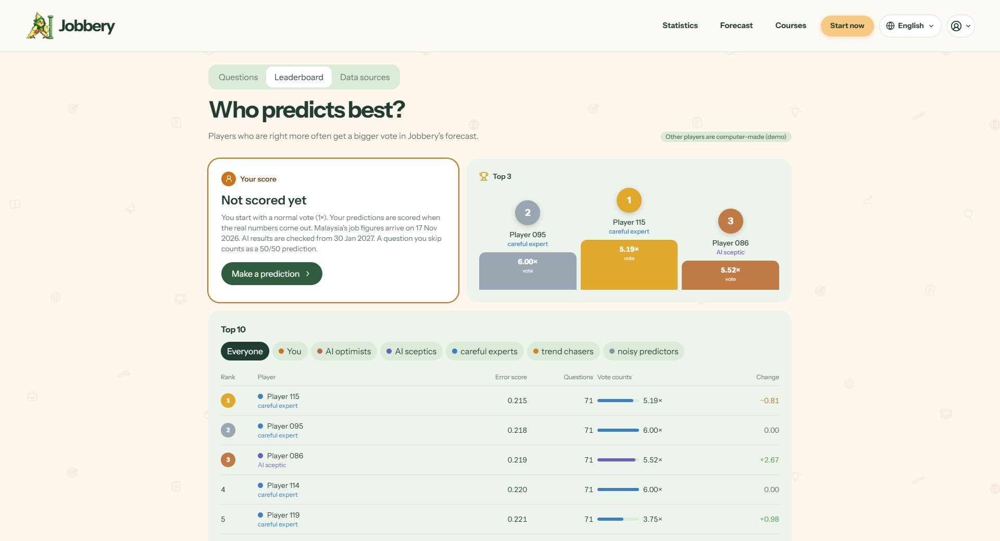

*The leaderboard shows rankings, accuracy scores and the influence earned by demo forecasters.*

---

## 12. Fairness check

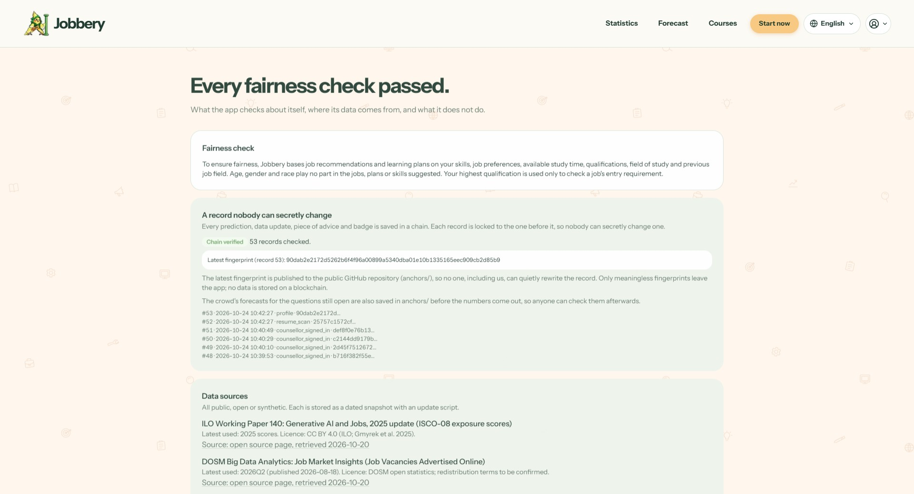

*The live Trust page reports the fairness result and verifies the tamper-evident record chain.*

- **Age, gender and background are never inputs.** Matching accepts only a whitelisted input type (`pickInputs`): skills, months, hours, interests, goals, qualification, field and area.
- **A test proves it.** The same skills with a different age or gender give exactly the same matches. Another test checks that the user's home state alone never changes their matches.
- **The check runs live** on the **Trust** page (`/trust`, via `/api/fairness`), along with hash-chain verification and the full list of data sources.
- **Tamper-evident log.** Every prediction, settlement, advice note and badge is added to a hash-chained log. Its fingerprint is committed to this repo (`npm run anchor`).
- **Labelled simulations.** Simulated forecasters and demo personas are always marked as made up. No real CVs or personal data are used.

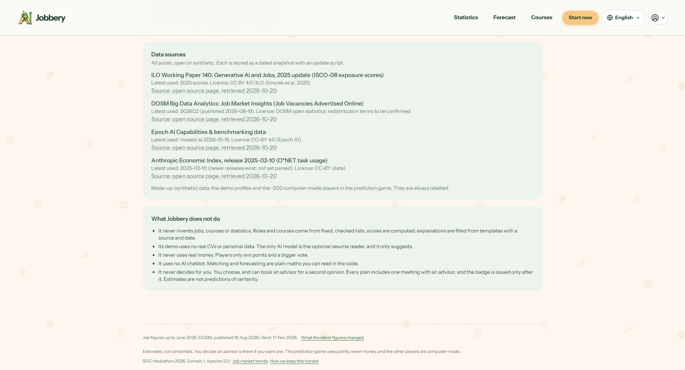

*The source list identifies the public datasets, their dates and the demo data.*

---

## 13. Coming next

### Inclusive design

- **Accessibility:** a full screen-reader and keyboard pass, larger text and high-contrast options, and plain-language reading level checks on every page.
- **Low-bandwidth mode** for older phones and patchy mobile data.
- **More starting points:** task cards for the other nine sectors, so users outside finance get the same AI-at-work practice.

### Automatic re-planning

Today, the plan is rebuilt when the user changes their job, hours or course choice, or when new data moves the futures. Next, it will re-plan on its own when life gets in the way:

- **Falling behind:** if steps run late, the remaining steps are rescheduled to the deadline, and the app says plainly whether the job is still reachable.
- **Running out of time:** if the deadline can no longer be met, it suggests a shorter route (a bridge plan or a closer role) for the user to choose.
- **New data:** when a release shortens a skill's expiry date, the steps for that skill move up or are swapped, and the "what changed and why" panel explains it.

The user always confirms a new plan before it replaces the old one.

---

## 14. Tech stack

| Layer | What we use |
|---|---|
| **Framework** | Next.js 16 (App Router), React 19, TypeScript |
| **Styling and motion** | Tailwind CSS 4, Framer Motion, Lucide icons |
| **Charts and map** | Recharts; a hand-drawn SVG map of Malaysia from geoBoundaries (no third-party base map) |
| **Engine** | Pure TypeScript in `src/lib/engine/`: LMSR market, simulated forecasters, history replay, futures weights, expiry dates, matching, planning |
| **Storage** | PostgreSQL (`pg`) when `DATABASE_URL` is set; SQLite (`better-sqlite3`) when running locally |
| **Sessions and trust** | Signed session cookie; SHA-256 hash-chained log, with its fingerprint committed to Git |
| **Resume scan** | `unpdf` (PDF) and `mammoth` (Word), with rule-based scoring. Optional AI reader: Qwen3.8 27B through the Groq API (`src/lib/server/ai-resume.ts`), with server-side checks and a rule-only fallback. |
| **Data pipeline** | The server fetches DOSM, Epoch AI and OpenDOSM itself, checks them and saves hashed snapshots (`src/lib/server/refresh.ts`); build scripts (`build-series.ts`, `build-geo.ts`) make the starting snapshot from raw downloads |
| **Tests** | Vitest: fairness, LMSR, futures weights, replay, matching, planning, log |
| **Hosting** | Vercel. No GPU needed: the AI model runs on Groq's hosted API. |

---

## 15. Run it

```bash
cd src
npm install
npm run dev
```

The app runs at http://localhost:3000. Other commands:

| Command | What it does |
|---|---|
| `npm test` | Runs the engine tests |
| `npm run typecheck` | Checks types |
| `npm run data:build` | Rebuilds the starting data snapshot from `data/raw/` |
| `npm run data:refresh` | Checks the sources for new data now (the app also does this by itself) |
| `npm run anchor` | Writes the hash log's fingerprint to `anchors/` |

Without `DATABASE_URL`, sessions are kept in `.data/jobbery.db` (SQLite). For a deployment with PostgreSQL, set `DATABASE_URL` and a random `SESSION_SECRET` in the Vercel project environment. Add `GROQ_API_KEY` there for the AI resume reader (locally, use `src/.env.local`, which is gitignored). Without that key, the rule scan runs alone.

### Demo shortcuts

Steps that normally need the user to stop and think have a dashed amber **"Demo:"** button, so the whole pathway can be shown in a few minutes:

| Where | Button | What it does |
|---|---|---|
| AI quiz (`/plan/task`) | Demo: mark every mistake correctly | Passes the quiz |
| Portfolio piece (`/plan/task`) | Demo: fill in a sample and save | Saves a sample prompt and sheet |
| Resume update (`/plan/resume`) | Demo: apply every fix and finish | Ticks every fix and finishes the step |
| Meet an advisor (`/advisor`) | Demo: skip to after the meeting | Sends labelled sample advice to the user's own booked meeting |

The sample user Hafiz and a finance job (e.g. tax preparer) show every step; quizzes for other fields come later.

For the advisor passcode and a judge's walkthrough, see [`src/README.md`](src/README.md).

---

## 16. Project structure

```text
.
├── .gitignore
├── .replit  # Repository-root run and deployment commands
├── LICENSE
├── README.md
├── src/  # Next.js application root; run npm commands here
│   ├── .env.example  # Environment variable template
│   ├── .gitignore
│   ├── .replit
│   ├── eslint.config.mjs  # Lint configuration
│   ├── LICENSE
│   ├── next.config.ts  # Next.js build configuration
│   ├── package-lock.json  # Locked dependency versions
│   ├── package.json  # Dependencies and npm scripts
│   ├── playwright.config.ts  # Browser-test configuration
│   ├── README.md
│   ├── tsconfig.json  # TypeScript configuration
│   ├── vitest.config.mts  # Unit-test configuration
│   ├── anchors/
│   │   └── forecasts-2026Q4.json
│   ├── data/  # Committed data snapshots
│   │   ├── courses.json
│   │   ├── logos.json
│   │   ├── occupations.json
│   │   ├── personas.json
│   │   ├── roles.json
│   │   ├── sdg.json
│   │   ├── series.json
│   │   ├── skill-keywords.json
│   │   ├── skills.json
│   │   ├── states.json
│   │   └── task-cards.json
│   ├── public/  # Production assets, including mascot images and illustrations
│   │   ├── geo/
│   │   │   └── malaysia-states.json
│   │   └── screenshots/  # README screenshots
│   ├── scripts/  # Data collection, builds, refresh and anchoring
│   │   ├── anchor-forecasts.ts
│   │   ├── anchor-log.mjs
│   │   ├── build-geo.ts
│   │   ├── build-map.mjs
│   │   ├── build-series.ts
│   │   ├── data-refresh.ts
│   │   ├── extract-state-occupation.mjs
│   │   ├── fetch-logos.mjs
│   │   └── fetch-sources.sh
│   ├── src/  # Application source code
│   │   ├── app/  # Pages, layouts, styles and API routes
│   │   │   ├── globals.css
│   │   │   ├── landing-v2.css
│   │   │   ├── layout.tsx
│   │   │   ├── page.tsx
│   │   │   ├── about/
│   │   │   │   └── page.tsx
│   │   │   ├── advisor/
│   │   │   │   └── page.tsx
│   │   │   ├── api/
│   │   │   │   ├── action/
│   │   │   │   │   └── route.ts
│   │   │   │   ├── counsellor/
│   │   │   │   │   └── route.ts
│   │   │   │   ├── data/
│   │   │   │   │   └── route.ts
│   │   │   │   ├── fairness/
│   │   │   │   │   └── route.ts
│   │   │   │   ├── leaderboard/
│   │   │   │   │   └── route.ts
│   │   │   │   ├── log/
│   │   │   │   │   └── route.ts
│   │   │   │   ├── market/
│   │   │   │   │   └── route.ts
│   │   │   │   ├── meetings/
│   │   │   │   │   └── route.ts
│   │   │   │   ├── resume/
│   │   │   │   │   └── route.ts
│   │   │   │   └── state/
│   │   │   │       └── route.ts
│   │   │   ├── badge/
│   │   │   │   └── [id]/
│   │   │   │       └── page.tsx
│   │   │   ├── changes/
│   │   │   │   └── page.tsx
│   │   │   ├── counsellor/
│   │   │   │   └── page.tsx
│   │   │   ├── courses/
│   │   │   │   ├── courses.css
│   │   │   │   └── page.tsx
│   │   │   ├── forecast/
│   │   │   │   └── page.tsx
│   │   │   ├── futures/
│   │   │   │   └── page.tsx
│   │   │   ├── goals/
│   │   │   │   └── page.tsx
│   │   │   ├── jobs/
│   │   │   │   ├── jobs.css
│   │   │   │   ├── page.tsx
│   │   │   │   ├── [id]/
│   │   │   │   │   └── page.tsx
│   │   │   │   └── all/
│   │   │   │       └── page.tsx
│   │   │   ├── leaderboard/
│   │   │   │   └── page.tsx
│   │   │   ├── map/
│   │   │   │   └── page.tsx
│   │   │   ├── market/
│   │   │   │   ├── market.css
│   │   │   │   ├── page.tsx
│   │   │   │   └── [id]/
│   │   │   │       └── page.tsx
│   │   │   ├── plan/
│   │   │   │   ├── page.tsx
│   │   │   │   ├── resume/
│   │   │   │   │   └── page.tsx
│   │   │   │   └── task/
│   │   │   │       └── page.tsx
│   │   │   ├── profile/
│   │   │   │   └── page.tsx
│   │   │   ├── radar/
│   │   │   │   └── page.tsx
│   │   │   ├── resume/
│   │   │   │   └── page.tsx
│   │   │   ├── skills/
│   │   │   │   └── page.tsx
│   │   │   ├── sources/
│   │   │   │   └── page.tsx
│   │   │   ├── start/
│   │   │   │   └── page.tsx
│   │   │   ├── trends/
│   │   │   │   ├── page.tsx
│   │   │   │   └── trends.css
│   │   │   └── trust/
│   │   │       └── page.tsx
│   │   ├── components/  # Shared UI components
│   │   │   ├── AiTrendCharts.tsx
│   │   │   ├── AppProvider.tsx
│   │   │   ├── AppShell.tsx
│   │   │   ├── CustomCursor.tsx
│   │   │   ├── ExpiryTrack.tsx
│   │   │   ├── ForecastDetails.tsx
│   │   │   ├── ForecastNav.tsx
│   │   │   ├── I18nProvider.tsx
│   │   │   ├── JobberyStrip.tsx
│   │   │   ├── JobBits.tsx
│   │   │   ├── JobIcon.tsx
│   │   │   ├── JobPicker.tsx
│   │   │   ├── JobsNav.tsx
│   │   │   ├── journey-bar.css
│   │   │   ├── Journey.tsx
│   │   │   ├── LandingForecast.tsx
│   │   │   ├── LandingIntro.tsx
│   │   │   ├── LandingLiveMarket.tsx
│   │   │   ├── LandingMap.tsx
│   │   │   ├── LandingSdgAnimation.tsx
│   │   │   ├── LanguageSwitcher.tsx
│   │   │   ├── MalaysiaMap.tsx
│   │   │   ├── MarketBoard.tsx
│   │   │   ├── MarketCards.tsx
│   │   │   ├── MarketTabs.tsx
│   │   │   ├── Meetings.tsx
│   │   │   ├── PageTransition.tsx
│   │   │   ├── Pathway.tsx
│   │   │   ├── ReleaseOverlay.tsx
│   │   │   ├── ResumePaper.tsx
│   │   │   ├── ResumeSheet.tsx
│   │   │   ├── ScoreRing.tsx
│   │   │   ├── SdgIcon.tsx
│   │   │   ├── Segmented.tsx
│   │   │   ├── SiteHeader.tsx
│   │   │   ├── SkipLink.tsx
│   │   │   ├── SourceDisclosure.tsx
│   │   │   ├── StepNav.tsx
│   │   │   ├── strands.ts
│   │   │   ├── ui.tsx
│   │   │   ├── useSelectJob.ts
│   │   │   └── useSpeed.ts
│   │   └── lib/
│   │       ├── build-resume.ts
│   │       ├── legacy.ts
│   │       ├── logo-domain.mjs
│   │       ├── malaysia-map.json
│   │       ├── map-figures.ts
│   │       ├── map-scale.ts
│   │       ├── market-math.ts
│   │       ├── sample-resume.ts
│   │       ├── suggested.ts
│   │       ├── datasrc/
│   │       │   ├── parse.ts
│   │       │   └── validate.ts
│   │       ├── engine/  # Forecasting, matching, learning plans and market logic
│   │       │   ├── calendar.ts
│   │       │   ├── data.ts
│   │       │   ├── expiry.ts
│   │       │   ├── futures-def.ts
│   │       │   ├── futures.ts
│   │       │   ├── geo.ts
│   │       │   ├── lmsr.ts
│   │       │   ├── market.ts
│   │       │   ├── matching.ts
│   │       │   ├── math.ts
│   │       │   ├── meetings.ts
│   │       │   ├── pathway.ts
│   │       │   ├── plan.ts
│   │       │   ├── questions.ts
│   │       │   ├── replay.ts
│   │       │   ├── resume.ts
│   │       │   ├── review.ts
│   │       │   ├── state.ts
│   │       │   ├── tape.ts
│   │       │   ├── view.ts
│   │       │   └── world.ts
│   │       ├── i18n/  # Translations and language helpers
│   │       │   ├── dates.ts
│   │       │   ├── dom.ts
│   │       │   ├── index.ts
│   │       │   ├── ms.ts
│   │       │   ├── ta.ts
│   │       │   ├── zh.ts
│   │       │   └── rows/
│   │       │       ├── forecast.ts
│   │       │       ├── humanedge.ts
│   │       │       ├── index.ts
│   │       │       ├── jobs.ts
│   │       │       ├── map.ts
│   │       │       ├── misc.ts
│   │       │       ├── misc2.ts
│   │       │       ├── plan.ts
│   │       │       ├── roles.ts
│   │       │       ├── sdg.ts
│   │       │       ├── skills.ts
│   │       │       ├── skillspage.ts
│   │       │       ├── sources.ts
│   │       │       ├── start.ts
│   │       │       ├── taskcard.ts
│   │       │       ├── trust.ts
│   │       │       └── updates.ts
│   │       └── server/  # Storage, sessions, data refresh and AI resume reader
│   │           ├── ai-resume.ts
│   │           ├── counsellor.ts
│   │           ├── meetings.ts
│   │           ├── refresh.ts
│   │           ├── respond.ts
│   │           ├── session.ts
│   │           ├── sources.ts
│   │           └── store.ts
│   └── tests/  # Unit tests and browser layout checks
│       ├── ai-resume.test.ts
│       ├── data-refresh.test.ts
│       ├── engine.test.ts
│       ├── i18n.test.ts
│       ├── layout-overflow.spec.ts
│       └── rename.test.ts
└── submission/  # Submission documents and pitch deck
    ├── Jobbery pitch deck.pdf
    ├── Jobbery pitch deck.pptx
    ├── Replit Proof Of Use.pdf
    ├── SDC2026_slaynergy_Preliminary.pdf
    └── SDC2026_slaynergy_TechDeclaration.pdf
```

This tree lists the tracked code, configuration, datasets and submission files. Individual images in `src/public/` and `src/public/screenshots/` are grouped under their folders.

The outer `src/` is the application root; `src/src/` contains its Next.js source code.
Local dependencies, build output, databases, logs and raw data downloads are excluded from Git.

---

## 17. How we used Replit and RunPod

**Replit.** We used Replit for code generation only.

**RunPod.** We did not use RunPod. Nothing needs a GPU on our side: the AI resume reader calls Qwen3.8 27B on Groq's hosted API, resume scoring is rule-based, and the forecasting engine is plain TypeScript.

## 18. How we use AI

Jobbery uses AI in two ways: one GenAI model that reads resumes, and a forecasting engine that learns from data. Neither one makes decisions for the user.

### 18.1 GenAI resume reader

| | |
|---|---|
| **Model** | Qwen3.8 27B (`qwen/qwen3.8-27b`), an open-weight model, through the Groq API |
| **Code** | `src/src/lib/server/ai-resume.ts`, called from `src/src/app/api/resume/route.ts` |
| **Must-have it serves** | Skills profile intake |
| **Switch** | "Also let AI read it" checkbox on the resume page (on by default) |

**What it does.** After the rule-based scan, the model reads the resume and returns JSON with two things:
1. **Extra skills** the keyword rules missed. They can only come from Jobbery's own list of 80 skills, and each one must quote the resume line it is based on.
2. **Better wording** for up to 5 weak lines (for example "Responsible for processing loan applications" becomes "Processed [how many] loan applications and verified supporting documents").

**The user stays in control.** AI skills appear as chips marked "· AI", unticked, with their quoted evidence. Each rewrite has Accept and Reject buttons. An accepted line can be edited, then copied into the user's own resume. Nothing changes unless the user chooses it. The resume score always comes from the rules, never from the AI.

**Checks so it cannot make things up.** The server drops anything the resume does not support (`checkAiRead`, tested in `src/tests/ai-resume.test.ts`):
- a skill ID that is not on Jobbery's list, or whose quote is not in the resume
- a rewrite of a line that is not in the resume
- a rewrite that adds a number the original line does not have (missing figures must be placeholders like `[how many]`)

The prompt also tells the model not to add purposes or overstate the role ("helped with" becomes "Supported", never "Led"), and to ignore instructions written inside the resume. We tested this with a resume that tried to inject a fake skill and fake numbers; both were ignored.

**Privacy.** The text is read in memory for that request and never stored or logged. If AI is on, it is sent once to Groq to be read. Only counts (how many AI skills and rewrites) go in the event log.

**Fallback.** With no `GROQ_API_KEY`, a Groq error, or a timeout (30 s), the rule scan runs alone and the page says so. Groq's free tier allows about 1,000 output tokens a minute (about two scans). After a rate-limit reply, the server waits once if the wait is short, and otherwise falls back to the rules.

### 18.2 A forecast that learns

The forecasting engine (`src/src/lib/engine/`) is statistical learning, not a language model. It keeps three possible speeds of AI change (slow, medium, fast) and weights them by how well each one predicted past official releases (DOSM job ads, Epoch AI benchmarks): log-likelihood scoring with fading memory, a form of Bayesian model averaging. A prediction market (LMSR, points only) adds the crowd's view of the next release. When a release settles the questions, the weights update, and so do every user's skill dates, job ranking and plan. See [section 8](#8-handling-uncertainty-how-the-forecasting-works).

### 18.3 What is not AI

Matching, the resume score, plans and every explanation are computed by readable rules and templates, so the same inputs always give the same answer and nothing invents jobs, courses or statistics. There is no chatbot.

### 18.4 AI used to build Jobbery

We used Claude Code (Anthropic) as a coding assistant while writing this repository. All code was reviewed and tested by the team.

---

## Licence

Apache License 2.0. See [LICENSE](LICENSE). Copyright 2026 #slaynergy.
